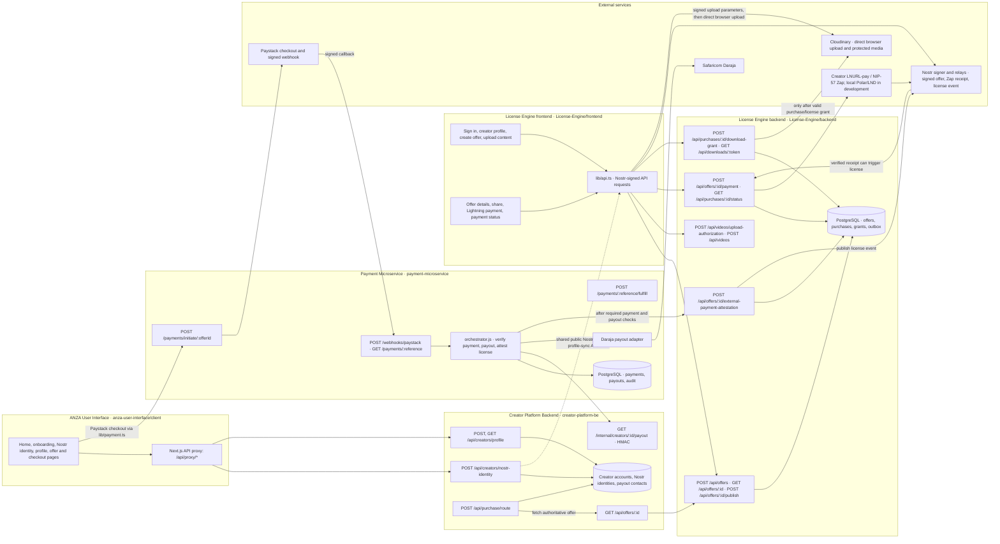

# ANZA License-Engine Backend API Guide

## Getting Started

### Prerequisites
- Node.js 22+
- npm
- PostgreSQL
- Optional: Docker

### Local Setup
1. `cd backend && npm install`
2. Copy `.env.example` to `.env` and configure:
   - `DATABASE_URL`
   - `NOSTR_OFFER_KIND`
   - `NOSTR_ATTESTOR_PUBKEY`
   - `NOSTR_RELAYS`
   - Optional: `PORT`, `HOST`, `PUBLIC_ORIGIN`, `CORS_ORIGINS`
3. `npm run migrate`
4. `npm start`
5. `npm test`

## System Architecture

Node.js HTTP API + PostgreSQL + Nostr outbox worker.

**Flow:**
1. Client sends signed request.
2. Middleware validates Nostr kind 27235 auth.
3. Services enforce rules and persist.
4. Outbox publishes Nostr events.
5. Payments resolve via LNURL-pay + NIP-57 receipts.

## API Interaction & Authentication

### Authentication
Protected routes require:
```
Authorization: Nostr <base64 kind-27235 event>
```
Event tags:
- `u`: full request URL
- `method`: HTTP method
- POST: `payload` (SHA-256 body), `contentport-idempotency-key`

### Mandatory Headers
- `Idempotency-Key` (POST)
- `X-Purchase-Token` (purchase status/download grant)

### Backend-Only Testing
- Generate Nostr keypair and sign events
- Use fixed idempotency keys
- Use 64-hex purchase tokens

## API Documentation & Testing

### Swagger UI
- Staging: https://anza-staging-172765911669.africa-south1.run.app/docs
- Local: http://localhost:3000/docs
- OpenAPI: `/docs/openapi.json`

### Postman Collection
https://www.postman.com/galactic-escape-972188/anza/collection/g4eqixa/contentport-api

## Endpoints

### Health
- GET /health/live
- GET /health/ready

### Offers
- POST /api/offers
- GET /api/offers
- GET /api/offers/{id}
- POST /api/offers/{id}/publish
- POST /api/offers/{id}/payment
- GET /api/offers/{id}/status

### Purchases
- GET /api/purchases/{id}/status
- POST /api/purchases/{id}/download-grant

### Downloads
- GET /api/downloads/{token}

### Videos (creator)
- POST /api/videos/upload-authorization
- POST /api/videos
- GET /api/videos
- GET /api/videos/{id}
- DELETE /api/videos/{id}

### Webhooks
- POST /api/webhooks/lightning
- POST /api/webhooks/speed/lightning

## Rapid Troubleshooting
- Missing env: check required vars
- Auth failures: verify signed event URL/method
- DB errors: run migrations
- Cloudinary errors: verify secret/timestamp
- Payment pending: check receipt on relays
## ANZA application floorplan


