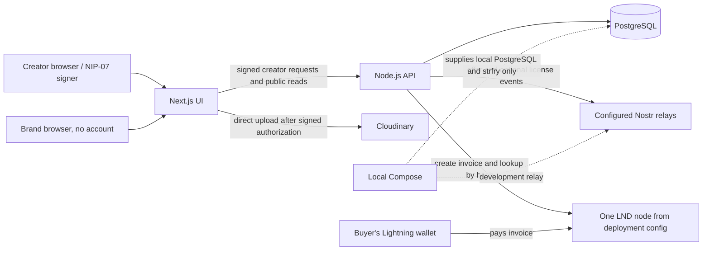

# ANZA Backend Production Readiness: Implementation Plan

**Status: For review and approval — no implementation phases are authorized yet.**

This plan records repository evidence and proposes the smallest changes needed to prepare the existing licensing engine for a controlled production path. It does not authorize code changes, database changes, provider selection, or deployment.

Paths below are relative to the `Licensing-Engine` repository root. Line references are to the inspected snapshot and should be rechecked when a phase starts. No secret values or `.env` contents were read.

## 1. Executive summary

The current product is a Node.js HTTP API and separate Next.js interface. The API stores offers and video metadata in PostgreSQL, verifies creator-signed Nostr events, queues offer and license events for relay publication, and signs Cloudinary upload parameters. The Lightning integration calls a single, locally configured LND REST endpoint. There is no creator payment destination field, creator-to-node mapping, buyer account, buyer acceptance record, payment table, license retrieval route, or protected original-download flow.

**Critical Lightning finding:** the LND node selected by `LND_REST_URL` creates the invoice. It is therefore the receiving node for that invoice. The documented Polar setup calls this the “Creator” node, so that particular demo can send value directly to that configured node. But the application does not establish that the node belongs to the creator associated with an offer; every offer uses the same deployment-level payment provider, and no subsequent payment to a creator exists. Runtime configuration and Polar node ownership are not in the repository, so the actual owner of any running node cannot be independently established.

The code has a useful foundation, but does not provide the intended end-to-end production purchase. In particular, public invoice creation is not per-creator or concurrency-safe, settlement is not linked to a buyer, license signing is optional, and the original media path is not protected for account-free buyers.

**Product decision recorded:** production should use creator Lightning Addresses (LNURL-pay) for direct-to-creator payments, while preserving the creator-signed offer and using an Anza attestor only to attest that Anza verified settlement and issued the license. The attestor signature is not independent proof that funds moved. The protocol's invoice-discovery flow does not itself supply a standard settlement callback to Anza, and no buyer-wallet preimage delivery is assumed. Phase 4 must begin with a focused, real test-environment proof of concept (PoC) for both recipient settlement evidence and buyer-wallet compatibility. If the PoC cannot verify settlement without relying on an unprovided buyer preimage or an untrusted client claim, stop at that gate; do not issue licenses or introduce an Anza-held balance/payout flow without explicit approval.

Preserve the existing Node API, PostgreSQL, Nostr, and Cloudinary integrations. A creator-controlled LND integration remains a technical fallback only if the Lightning Address path cannot provide the required settlement evidence and the user separately approves that alternative. Staging infrastructure may be prepared with payment features disabled.

## 2. Current architecture

### Verified components

| Component | Current role | Evidence |
|---|---|---|
| Next.js interface | Creator offer/content UI, public offer pages, and Lightning invoice/status UI. | `frontend/package.json`; `frontend/app/`; `frontend/lib/api.ts` |
| Node.js API | Native Node HTTP server and route matching; offer/content services and publication worker. | `backend/package.json`; `backend/src/server.js`; `backend/src/app.js` |
| PostgreSQL | Persists offer JSON documents, video records, idempotency records, upload sessions, Nostr outbox, and webhook receipts. | `backend/src/repositories/offers.js`; `backend/src/repositories/videos.js`; `backend/src/database/migrations/` |
| Cloudinary | Direct browser uploads authorized by API-signed parameters; watermarked preview/thumbnail URL construction. | `backend/src/services/media/cloudinary.js`; `backend/src/services/content/service.js` |
| Nostr | Creator-signed offer event, optional attestor-signed license event, relay publication via durable outbox. | `backend/src/services/nostr/events.js`; `backend/src/services/nostr/publisher.js`; `backend/src/services/offers/service.js` |
| LND / Polar | LND REST API client that creates invoices and checks them by payment hash. Config is restricted to an HTTPS localhost origin; README documents local Polar regtest. | `backend/src/services/payments/lnd-client.js`; `backend/src/config/index.js`; `README.md` |
| Local relay | strfry service in Compose for development. | `compose.yaml`; `strfry.conf` |
| Deployment platform | No tracked Cloud Run, Render, or Vercel deployment configuration found. | Tracked repository file listing; `compose.yaml` contains only local PostgreSQL and strfry. |

### Current flow



The buyer payment-to-node arrow expresses Lightning invoice mechanics and the application's configured receive invoice; the repository does not verify who controls that node. “Creator node” is the README's label for the local Polar node, not a stored creator-to-node relationship.

## 3. Confirmed findings from the code

### Offer, identity, and API

- `frontend/lib/nostr.ts` exposes NIP-07 `getPublicKey()` and `signEvent()` usage. It keeps creator private keys in the browser signer rather than sending them to the backend.
- `backend/src/middleware/auth.js` validates signed HTTP authorization events (kind 27235), binds protected requests to URL/method, and binds POSTs to body digest and idempotency key.
- `backend/src/services/offers/service.js` validates offer terms, derives identity from the authenticated public key, verifies publication events, and persists the draft/publication state.
- `backend/src/routes/offers.js` implements `POST /api/offers`, public `GET /api/offers`, `GET /api/offers/{id}`, `POST /api/offers/{id}/publish`, public `POST /api/offers/{id}/payment`, public `GET /api/offers/{id}/status`, plus two Speed-shaped webhook paths.
- `backend/src/routes/content.js` implements creator-authenticated video upload authorization, registration, list, read, and delete routes.
- There is no creator-profile/onboarding persistence or payment destination in `schemas.Creator`, the offer draft schema, the video schema, or migrations.
- `backend/docs/api-contract.md` and `backend/src/contracts/contract.js` include planned plural `/payments` paths, buyer acceptance, and buyer/creator authorization that are not implemented. The live route matcher uses singular `/payment` and `/status`.

### Source line references

These are code locations for the verified findings above; confirm line numbers again before implementation.

| Finding | Source references |
|---|---|
| Frontend API origin and payment calls | `frontend/lib/api.ts:16` (`API_BASE_URL`), `:109` (`createOffer`), `:184-193` (`createPaymentRequest`, `getOfferStatus`); `frontend/app/offers/[offerId]/pay/page.tsx:55-60` (invoice initiation), `:74-90` (status polling) |
| Nostr creator authentication | `frontend/lib/nostr.ts:99-127` (`signHttpAuthorization`); `backend/src/middleware/auth.js:7-24` (`authenticate`) |
| API routes and access | `backend/src/routes/offers.js:1-16` (`matchOfferRoute`, webhook routes); `backend/src/routes/content.js:1-10` (`matchVideoRoute`) |
| Offer create and publication | `backend/src/services/offers/service.js:47-75` (`create`); `:100-123` (`publish`) |
| Invoice request, response validation and persistence | `backend/src/services/offers/service.js:125-149` (`createPayment`); `backend/src/repositories/offers.js:15-22` (`saveOfferDocument`) |
| LND endpoint restriction, TLS and invoice APIs | `backend/src/config/index.js:40-48` (`readLndUrl`); `backend/src/services/payments/lnd-client.js:4-12` (local HTTPS transport with `rejectUnauthorized: false`), `:21-28` (client and localhost restriction), `:29-47` (`lookupInvoice`), `:49-75` (`createInvoice`) |
| Settlement and conditional license signature | `backend/src/services/offers/service.js:34-45` (`queueLicenseAttestation`); `:151-175` (`getStatus`); `backend/src/services/nostr/events.js:21-40` (`buildLicenseEvent`) |
| Webhook wiring | `backend/src/services/offers/service.js:177-189` (`lightningWebhook`); `backend/src/services/payments/speed.js:5-22` (`verifySpeedWebhook`); `backend/src/server.js:15-17` (service config spread); `backend/src/config/index.js:63-84` (`readConfig`, no Speed secret) |
| Nostr outbox and relay retry/quorum | `backend/src/repositories/offers.js:24-40` (`queueLicense`), `:90-116` (`publishNext`, one stored ACK and retry); `backend/src/services/nostr/publisher.js:30-40` (`Promise.any`) |
| Cloudinary upload, originals and previews | `backend/src/services/content/service.js:20-30` (`owned` includes `original_url`), `:33-68` (upload authorization and client registration), `:70-90` (owner library/get/delete); `backend/src/services/media/cloudinary.js:14-35` (watermarked preview and ordinary original URL), `:49-83` (upload authorization and asset reference) |
| Schemas and missing persistence/routes | `backend/src/models/schemas.js:14-42` (terms/creator/offer/payment/license shapes), `:62-69` (`OfferDraft`); `backend/src/models/commerce.js:36-41` (`DownloadGrant` schema only); migrations `backend/src/database/migrations/001_offers.sql:2-30`, `002_videos.sql:6-27`; route inventory above |
| Runtime, CORS and deployment | `backend/src/app.js:9-35` (CORS and server timeouts), `:66-85` (auth/errors); `backend/src/server.js:20-28` (worker/listen/shutdown); `backend/src/config/index.js:63-84` (host/port config); `backend/package.json:6-12` (Node version/scripts) |
| Existing tests and skipped DB coverage | `backend/test/day2.test.js:53-113`, `:210-282`; `backend/test/lnd-client.test.js:5-39`; `backend/test/postgres.test.js:27-58` (requires `TEST_DATABASE_URL`); `backend/test/content.test.js`; `backend/test/contracts.test.js` |

### Database and migrations

- `backend/src/database/migrations/001_offers.sql` creates `offers`, `api_requests`, `nostr_outbox`, and `lightning_webhooks`.
- `backend/src/database/migrations/002_videos.sql` creates `videos`, adds `offers.video_id`, and creates `upload_sessions`.
- These are version-controlled SQL migration files, but there is no migration-history table. `backend/scripts/migrate.js` applies every `.sql` file in sorted order each run; current SQL statements are mostly guarded with `IF NOT EXISTS`.
- No seed script was found. `backend/src/server.js` expects PostgreSQL to be initialized and fails at startup if it cannot query `nostr_outbox`.
- PostgreSQL access uses `pg.Pool` and `DATABASE_URL`. The package declares `pg`; no Supabase integration or configuration exists. Supabase's PostgreSQL endpoint could potentially be used as PostgreSQL, subject to connection and TLS configuration verification.

### Test baseline recorded for this plan

Executed `npm test` from `backend/` on 2026-10-22:

- **54 tests discovered; 52 passed, 0 failed, 2 skipped.**
- The skipped tests are the PostgreSQL transaction/outbox and content-persistence integration tests; the runner says to set `TEST_DATABASE_URL` to a disposable PostgreSQL database.
- Existing tests include validation/contracts, Nostr event construction, offer rules, mocked LND invoice creation/settlement, webhook HMAC behavior, Cloudinary signature generation, and content ownership. The LND tests use mocked responses; they do not establish production payment behavior.
- Running `npm test` at repository root returned “Missing script: test”; the test script is defined under `backend/package.json`.
- The manifests do not define a backend lint, format, type-check, or static-analysis script. The frontend has a Next lint script, but it is not a backend validation command.

These results are a baseline, not proof that untested PostgreSQL, Polar, Cloudinary, live relay, or Cloud Run behavior works.

## 4. Critical finding: existing Lightning payment flow and production path

### Current flow, end to end

1. A creator submits a draft through `frontend/lib/api.ts` → `POST /api/offers`. The API accepts licensing terms and optional `video_id`; it does not accept a Lightning Address, wallet ID, creator node ID, invoice, payment-provider account, or destination.
2. The creator signs the offer using the injected Nostr signer. The backend verifies it and queues the event for relay publication.
3. The brand opens the payment page. `frontend/app/offers/[offerId]/pay/page.tsx` calls `createPaymentRequest()` in `frontend/lib/api.ts`, which issues an unauthenticated `POST /api/offers/{id}/payment`.
4. `backend/src/services/offers/service.js` reads the offer amount and calls the single configured `paymentProvider.createInvoice({ amountSats: offer.terms.amount_sats, ... })`.
5. `backend/src/services/payments/lnd-client.js` posts to `/v1/invoices` at the LND endpoint in `LND_REST_URL`, with the configured LND macaroon. LND returns a BOLT11 invoice, which the service checks for a payment request, hash, and amount matching the offer, then stores as fields on that offer document.
6. The API returns `{ offerId, amountSats, paymentRequest }`. No buyer identifier or buyer acceptance is recorded.
7. The brand pays the invoice using a compatible Lightning wallet. On Lightning, the invoice's payee is the node that created/issued the invoice. In the documented Polar demo, that is the configured Polar “Creator” LND node. In a deployment, it is whichever node `LND_REST_URL` actually reaches; no code proves who owns that node.
8. The browser polls `GET /api/offers/{id}/status`. The backend looks up the stored payment hash through the same LND node. When LND reports settled, the backend saves `status: settled` and `settled_at` in the offer document.
9. If `NOSTR_ATTESTOR_PRIVATE_KEY` is configured, the backend builds and signs a license event and stores it in the Nostr outbox. The publisher attempts configured relays and considers the event published after one positive acknowledgement.
10. The flow stops at payment status/license event publication. There is no creator payout step and no licensed-buyer download authorization.

```mermaid
sequenceDiagram
  participant C as Creator browser
  participant UI as Next.js UI
  participant API as Licensing API
  participant DB as PostgreSQL
  participant LND as Configured LND node
  participant B as Brand wallet
  participant N as Nostr relays
  C->>UI: Enter offer terms and sign with NIP-07
  UI->>API: POST /offers (signed creator authorization)
  API->>DB: Save draft
  UI->>API: POST /offers/{id}/publish (creator-signed event)
  API->>DB: Queue offer event
  API->>N: Publish exact event; one ACK marks published
  B->>UI: Open shared offer link
  UI->>API: POST /offers/{id}/payment (public)
  API->>LND: Create invoice for stored offer amount
  LND-->>API: BOLT11 invoice + payment hash
  API->>DB: Save invoice in offer document
  API-->>UI: Invoice, amount, offer ID
  B->>LND: Pay invoice; this LND node receives the payment
  UI->>API: GET /offers/{id}/status (poll)
  API->>LND: Lookup invoice by payment hash
  LND-->>API: Settled state and settlement timestamp
  API->>DB: Save settlement in offer document
  opt Attestor private key configured
    API->>DB: Sign and enqueue license event
    API->>N: Publish license event; one ACK marks licensed
  end
  Note over API,B: No creator payout or buyer download grant is implemented
```

### Payment destination and creator payment

**How does the current implementation determine who receives the buyer's Lightning payment?** It does not look up a recipient from the offer or creator. The single deployment-level `LND_REST_URL` chooses the node that creates the invoice; that same node is queried for settlement. Consequently, that node is the invoice payee and receives the payment if it settles.

The README documents a Polar test with “Buyer” and “Creator” nodes in the same Polar network and configures the “Creator” node's REST port/macaroon. This demonstrates a direct payment to that configured demo node only if the Polar instance is configured as described and that node is operated for the creator. The repository contains no Polar topology/configuration file and cannot establish the running node's owner. It does not prove a different creator's node is selected for different offers.

No function sends an onward Lightning payment to the creator. No Lightning Address is accepted, resolved, or stored. No payout/withdrawal workflow exists. The code therefore does **not** route every buyer's payment to the corresponding creator unless deployment ownership is manually arranged so the single configured node is that creator's node; it cannot safely support multiple creators with distinct destinations as written. Under a deployment where Anza controls the configured node, that node would receive the payment, and the system has no mechanism to pass it on.

The local LND adapter builds an invoice using the exact stored offer price and checks the returned invoice amount against it. It then persists the amount and invoice hash in the offer JSON document. Settlement lookup verifies that the returned hash matches the requested hash and reads LND's settled status; the service trusts the previously stored amount rather than independently rechecking a settled invoice's amount/destination. No buyer is associated with the payment.

### Code-reference table

| Flow element | Code evidence | What the code establishes / limitation |
|---|---|---|
| Creator payment destination capture | `backend/src/models/schemas.js` (`Terms`, `Creator`, `OfferDraft`); `backend/src/services/offers/service.js:create`; migrations `001_offers.sql`, `002_videos.sql` | No destination is accepted or persisted. `Creator` is a schema only; no creator table/onboarding route exists. |
| Payment initiation | `frontend/app/offers/[offerId]/pay/page.tsx`; `frontend/lib/api.ts:createPaymentRequest`; `backend/src/routes/offers.js:matchOfferRoute` | Anonymous buyer calls public singular `/payment`; request carries offer ID only. |
| Invoice creation and payee | `backend/src/services/offers/service.js:createPayment`; `backend/src/services/payments/lnd-client.js:createLndClient().createInvoice`; `backend/src/config/index.js:readLndUrl` | One configured localhost LND node creates invoices. That node is the invoice payee. Config explicitly rejects non-local LND URLs; the client disables TLS verification for this localhost development call. |
| Offer amount association | `backend/src/services/offers/service.js:createPayment` | Invoice creation uses `offer.terms.amount_sats`, checks provider-returned amount, and stores invoice/hash/amount in that offer document. Concurrent calls can each create an invoice before either saves; no `idempotent()` transaction wraps external invoice creation. |
| Settlement detection | `frontend/lib/api.ts:getOfferStatus`; `backend/src/services/offers/service.js:getStatus`; `backend/src/services/payments/lnd-client.js:lookupInvoice` | Polling triggers backend lookup by stored hash; confirmed only when LND says settled. No webhook is used for this LND flow. |
| Payment persistence | `backend/src/repositories/offers.js:getOffer`, `saveOfferDocument`; `001_offers.sql` | Payment is nested in `offers.document`; there is no `payments` table, buyer record, destination field, or unique payment-hash constraint. |
| Webhook path | `backend/src/routes/offers.js:matchWebhookRoute`; `backend/src/services/offers/service.js:lightningWebhook`; `backend/src/services/payments/speed.js:verifySpeedWebhook`; `001_offers.sql` | Speed-shaped HMAC callback stores a receipt only. `readConfig()` does not expose a Speed secret, and `server.js` spreads config into the service, so this handler receives no configured secret and returns not configured. It does not settle an LND payment. |
| License event construction | `backend/src/services/offers/service.js:queueLicenseAttestation`; `backend/src/services/nostr/events.js:buildLicenseEvent` | Requires `settled_at` and the optional attestor private key. The event references offer event ID and creator pubkey and includes payment hash, amount and term dates; terms are in the referenced offer event. |
| License persistence | `backend/src/repositories/offers.js:queueLicense` | Stores `license_event_id`, `licensed_at`, and `licensing` status in offer JSON and inserts signed event into outbox; no standalone license row or retrieval endpoint. |
| Relay publication | `backend/src/server.js` worker; `backend/src/repositories/offers.js:publishNext`; `backend/src/services/nostr/publisher.js:createRelayPublisher` | Retries failed outbox messages with capped backoff; `Promise.any` lets one configured relay ACK mark publication. No three-relay quorum, relay retrieval, or independent availability guarantee. |
| Creator payout | Search of payment service, routes, migrations, and frontend API | No send-payment, payout, or withdrawal implementation. The selected Lightning Address model is a future direct-receive destination, not a payout mechanism. |
| Buyer download grant | `backend/src/services/content/service.js:owned`, `listMine`, `getOne`; `backend/src/services/media/cloudinary.js:originalUrl`; `backend/src/routes/content.js` | No grant/token/download route. Owner library responses include an ordinary original Cloudinary URL; discovery excludes it. No buyer gets authorization after purchase. |

### What Polar demonstrates — and does not

The tracked README describes a local Polar regtest network, a Buyer LND node, a Creator LND node, channel setup, invoice scan/payment, and status polling. The service's default URL and strict localhost check, `polar-lnd` adapter name, and LND client tests align with local Polar development. BOLT11's `lnbcrt` prefix denotes regtest; such an invoice is not payable on Bitcoin mainnet.

This setup can demonstrate a buyer node paying an invoice issued by the configured Creator node and the API observing that node's settlement. It does not demonstrate public/testnet/mainnet payment, per-creator recipient selection, Lightning Address discovery, production node security, business account ownership, creator onboarding, a creator payout, or buyer download authorization. No Polar network export, node configuration, channel backup, or reproducible Polar creation script is tracked. Exact node names/ports and channels must be checked in the Polar desktop application.

### Smallest viable production paths

The approved product model is **creator Lightning Address (LNURL-pay) → amount-bound invoice → buyer pays from their wallet → authoritative recipient-side settlement evidence → Anza attestation**. LNURL-pay provides address resolution and invoice acquisition; that alone is not settlement evidence.

#### What the protocol does and does not prove

- LUD-16 specifies resolving `user@domain` at `/.well-known/lnurlp/user`; the service response follows LUD-06.
- LUD-06 specifies the payRequest metadata/limits, wallet callback to obtain a BOLT11 invoice, wallet amount check, and then wallet payment. It does **not** define a standard post-payment callback to Anza, invoice-status API available to arbitrary third parties, or a step that sends the buyer's preimage to the merchant.
- A payer's wallet necessarily participates in payment and may internally learn a preimage, but the LNURL-pay flow does not require the wallet to disclose that preimage to Anza. Do not make buyer-preimage submission a hidden assumption or regard a browser statement that payment succeeded as proof.
- The recipient node/provider can often observe invoice settlement; LND documents invoice subscriptions and lookup/list operations for invoices stored by that node. A generic Lightning Address does not give Anza credentials or a standard endpoint to query the receiving service. Whether the selected creator/address service offers an authenticated status API, webhook, or a creator-authorized way to query that invoice is service-specific and remains unverified.
- BOLT11 invoices encode an amount when fixed and identify invoice/payment data, but a valid invoice is not evidence it was paid. Validate its network, amount, payment hash, expiry and payee data before presenting it. The invoice's node/payee identity by itself does not establish the real-world creator beneficiary if a third-party address provider operates the receiving node.

**Consequent gate:** Phase 4 must begin with a focused PoC using a creator-controlled Lightning Address service and at least two representative external wallets (one wallet should not be assumed to expose or transmit a preimage). The PoC must resolve the address, obtain and inspect the returned invoice, pay it, verify that the payment was credited to the intended creator-controlled beneficiary, and independently confirm final settlement from an authoritative recipient/provider source without requiring the buyer to send Anza a preimage. Record exact service, wallet versions, invoice/network details, callback/API/webhook behavior, confirmation latency, expiry/duplicate/retry behavior, and evidence. Use testnet/sandbox funds only; do not use production value.

**Stop condition:** if no recipient-side API/webhook/creator-authorized invoice status or other reliable evidence is available to Anza without a buyer-preimage handoff, stop Phase 4 before implementation of license-triggering payment logic. Present the observed limitation and seek approval among: (a) a creator-authorized receiver service with authoritative invoice-status access; (b) a creator-controlled LND/node integration as a separately approved alternative; or (c) a buyer-wallet proof flow only if named wallet APIs demonstrably return a verifiable preimage and the product accepts wallet compatibility restrictions. Do not use a client success claim. Do not introduce an Anza-held balance, provider credit, or separate payout service without explicit approval.

#### Offer destination binding and address changes

The creator's Lightning Address must be associated with the creator's Nostr-authenticated identity through an explicit proof/confirmation step; a submitted string alone does not prove control or beneficiary. At offer publication, bind the exact normalized address and a destination/version reference into the signed offer (or another immutable, creator-signed offer-version record). Persist a snapshot on every purchase, including normalized address, address domain/resolution target, resolved invoice payee data, amount, network, payment hash, expiry, offer event ID, creator public key, and payment ID. The address string can be publicly visible in the signed offer; do not include provider credentials or private account data.

After publication, changing the creator's default address must not silently change that offer's destination or rewrite its signed terms. The creator must publish a new signed offer/version for new purchases, or explicitly close the old offer and publish a replacement. An already-created invoice remains associated with its original purchase and resolved destination until it expires or settles. If an address is no longer usable, disable new purchase initiation for affected offers and require a new signed version; never redirect a pending invoice to the new address. Record old and new destination versions for audit.

The signed offer/payment association proves what destination was selected and what invoice was issued; it does not alone prove that the creator controls the address or that a provider credited the creator. The PoC and creator-address verification design must establish the beneficiary relationship and settlement evidence.

References checked: [BOLT 11 invoice protocol](https://github.com/lightning/bolts/blob/master/11-payment-encoding.md), [LUD-06 payRequest](https://github.com/lnurl/luds/blob/luds/06.md), [LUD-16 Lightning Address](https://github.com/lnurl/luds/blob/luds/16.md), and [LND receiving invoices and invoice monitoring](https://docs.lightning.engineering/lightning-network-tools/lnd/receiving). These specifications do not establish the behavior, custody, APIs, fees, availability or regulatory suitability of an unspecified creator address provider in Kenya.

### Decision status

**Resolved product decision:** use creator Lightning Addresses (LNURL-pay) as the intended direct-to-creator model; keep purchases account-free; preserve creator signature on the offer; Anza's attestor signs only the claim that Anza verified payment and issued a license; do not introduce an Anza-held balance or payout service without explicit approval.

**Unresolved technical gate, not an open product choice:** which Lightning Address service and recipient-side settlement evidence mechanism can pass the Phase 4 PoC with compatible external wallets and no buyer-preimage assumption. Provider and wallet compatibility, recipient beneficiary proof, and settlement observability must be measured before payment implementation. If no option meets the stop criteria, pause and ask for approval on the alternatives above.

## 5. Known gaps and risks

### Confirmed from code

| Priority | Finding | Practical impact / planning response |
|---|---|---|
| Critical for direct multi-creator payments | All offers use one deployment-level LND client; no Lightning Address or destination is associated with creator or offer. | Current payment path cannot direct each offer to its creator. Implement the approved Lightning Address model only after its PoC passes; bind an immutable offer destination version and per-purchase snapshot. |
| Critical for settlement proof | LNURL-pay's standard flow returns an invoice to the payer; it does not define a post-payment notice/status query for Anza. The buyer wallet is not required to disclose a preimage. | Do not issue a license based on invoice creation, browser claims or a generic LNURL response. Prove an authoritative recipient/provider status mechanism that Anza can use without relying on buyer-preimage handoff, or stop Phase 4 for a decision. |
| Critical for licensed downloads | No buyer download-grant route or purchase receipt exists; original delivery URLs are ordinary Cloudinary URLs and exposed in owner library responses. | No safe way for a no-account buyer to obtain the original after payment or prevent unauthorized access if original is public. Confirm Cloudinary account access settings; then add short-lived/revocable purchase-bound grants. |
| High | Public `POST /payment` can create invoices concurrently; it does not require acceptance, buyer credential, idempotency key or transaction lock around provider creation. | Can create multiple payable invoices for one offer; late payment cannot be reconciled safely. |
| High | Payment record is embedded on offer JSON; no payment uniqueness/foreign-key/buyer association. | No durable multi-attempt payment ledger or buyer-specific recovery. |
| High | Webhook secret is not loaded/passed by server config; handler stores callbacks rather than processing/reconciling settlement. No timestamp freshness or event dedupe. | Do not use Speed callback as payment authority. Polling LND is the active settlement path. |
| High | Optional attestor private key means settlement can be reported without creating a license event. | Define production key custody and make “settled” vs “license published” distinct states and acceptance checks. |
| High | CORS `isAllowedOrigin` permits only HTTP localhost; parsed `corsOrigin` is not used. | Hosted browser UI at HTTPS domain cannot successfully make cross-origin API calls with current CORS response behavior. |
| High for Cloud Run | Default host is `127.0.0.1`; Cloud Run ingress expects `0.0.0.0` and injected port. Start script explicitly loads `.env`. | Runtime startup changes and container test required before deployment. |
| Medium | Raw public offer read returns the stored offer document, which may include payment invoice/hash/status fields. | Establish response projection/privacy contract before external API release. |
| Medium | Nostr publisher accepts one relay ACK, not a three-relay quorum; no event retrieval endpoint. | Match reliability policy to intended “independently verifiable” claim; ensure relay query verification tests. |
| Medium | `VideoRegistration` trusts browser-supplied Cloudinary status and metadata; original bytes are not verified by backend. | Verify asset with Cloudinary API/webhook before treating it ready or signing it as authoritative content. |
| Medium | Root README has schema naming drift (`ANZA.offer.v1` in prose vs `contentport.offer.v1` in code); API docs include planned routes as if in the contract. | Reconcile docs and API versioning in Phase 3; no event-format migration without compatibility review. |
| Medium | The API has no evident health/readiness route, rate limit, or production deployment pipeline/config. | Add only necessary runtime/operational controls and protect public routes before exposure. |
| Medium | No `LICENSE` file is tracked; README lists selecting one as future work. | Confirm the open-source boundary and license before external open-source release. |

### Requires account/runtime verification

- Cloudinary can be configured for private/authenticated delivery, but the repository does not reveal the account's delivery/access policy or current asset settings. Do not claim that current originals are all public or all private.
- The owner library endpoint returns an un-tokenized URL for the original asset. If the asset is publicly deliverable under account settings, anyone who obtains that URL can fetch it; if account policy protects it, delivery behavior depends on configuration. Verify both in the real account before launch.
- No code/config proves a Cloud Run service, managed database, Render service, DNS record, GitHub deployment pipeline, or business ownership of provider accounts.
- No backend `.env.example` is tracked even though backend setup docs refer to one. An untracked root `.env` exists in worktree status; it was not opened or copied.
- No repository evidence verifies a Voltage account, Kenya eligibility, current fee schedule, custody arrangement, or settlement terms.

## 6. Proposed target behavior

Preserve the intended creator-led/account-free brand journey:

1. Creator authenticates with Nostr signing capability; no private key is sent to the API.
2. Creator uploads to Cloudinary using a server-signed, restricted authorization. Backend confirms the resulting asset and processing state through trusted Cloudinary evidence.
3. Creator creates and signs an immutable offer that references verified content and fixed terms. Offer includes only what is needed for the creator's chosen payment destination (recommend a Lightning Address or reference to an authorized creator-controlled node, never a raw secret).
4. Brand opens public offer details and watermarked preview without registration.
5. Brand chooses purchase; API records the exact offer/terms acceptance without requiring an identity account, creates a per-purchase payment record and returns a one-time invoice and high-entropy account-free receipt secret/link.
6. Payment is confirmed using the recipient/address service's authoritative invoice status or webhook/API, reconciled to the expected invoice and exact offer. No buyer preimage is assumed; a frontend redirect, invoice generation, unsigned webhook, or public Nostr assertion is not proof.
7. Idempotently record verified settlement and create one license linked to that payment and offer. Anza's attestor signs only the claim that Anza verified settlement and issued the license; it does not independently prove that funds moved.
8. Publish the exact signed event through the outbox, record acknowledgements and retry unchanged event bytes. Nostr event provides independently retrievable signed attestation; it does not prove payment independently unless verifier trusts the attestor's settlement process.
9. Return a secure, revocable, expiring download grant to the purchase receipt holder. Serve a short-lived protected Cloudinary delivery link or equivalent private delivery, never expose a permanent original URL publicly. Buyer does not need an account.
10. Creator receives payment directly at the invoice's creator-controlled Lightning destination; no Anza-held balance or later payout is added without explicit approval.

## 7. Phased implementation plan

Phases are dependency-ordered. Each phase requires targeted tests, the existing backend suite, applicable static checks, an actual-results report, and an update to this plan before proceeding. A failed acceptance criterion pauses subsequent phases.

### Phase 0 — Code audit and baseline

- **Objective:** establish verified behavior before changing it.
- **Current state:** route/service/database/payment/media/Nostr paths were traced for this plan. Backend `npm test`: 52 pass, 0 fail, 2 skipped PostgreSQL integration tests. No actual Polar, Cloudinary, relay, Supabase, or Cloud Run integration was run.
- **Required changes:** none; this planning task is the audit. Before implementation starts, recheck all cited files and determine which untracked state is in-scope without opening or staging secrets.
- **Files to inspect:** `backend/src/services/offers/service.js`, `backend/src/services/payments/lnd-client.js`, `backend/src/services/nostr/`, `backend/src/services/content/service.js`, `backend/src/services/media/cloudinary.js`, `backend/src/repositories/`, `backend/src/database/migrations/`, `backend/src/routes/`, `backend/test/`, root `README.md`, backend docs.
- **Expected files to modify:** only `implementation-plan.md` during this plan task. During later execution, none for Phase 0 unless findings require a separately approved scope.
- **Expected modules:** offer/payment/content services, repositories, config, native HTTP app/server, and outbox.
- **Implementation steps:** mark baseline, clarify documented facts vs assumptions, capture test result, record live-infrastructure unknowns.
- **Database changes:** none.
- **API changes:** none.
- **Testing requirements:** baseline already run; rerun when Phase 0 is approved if source changed. Run PostgreSQL integration only with a clearly disposable database and explicit confirmation of its target.
- **Acceptance criteria:** all payment destination and signing claims cite code; skipped tests and unavailable systems remain explicitly identified.
- **Risks/dependencies:** current worktree includes untracked `.env`, `.kilo/`, and generated `frontend/tsconfig.tsbuildinfo`; do not modify or stage unrelated changes.
- **Rollback/recovery:** no application changes to roll back.
- **Approval gates:** approve the audit conclusions and select/authorize safe test PostgreSQL only if Phase 2 requires it.

### Phase 1 — Backend runtime and deployment readiness

- **Objective:** run the existing Node API as an independently deployable Cloud Run container without changing product behavior.
- **Current state:** `backend/src/server.js` uses `config.host`, `config.port`, and a periodic outbox worker. `backend/src/config/index.js` defaults host to loopback and reads app config. `backend/package.json` starts with `node --env-file=.env`. No health route/container is tracked. CORS uses a localhost-only predicate rather than `corsOrigin`.
- **Required changes:** support platform-provided `PORT`; bind to `0.0.0.0` under Cloud Run (while preserving local behavior); make `.env` optional for platform startup; add health/readiness checks; implement exact configured origin allowlist; document graceful shutdown and external dependency status; decide whether outbox worker is safe as an in-process worker with chosen Cloud Run CPU/min-instance settings or requires a separate process.
- **Files to inspect:** `backend/src/config/index.js`, `backend/src/server.js`, `backend/src/app.js`, `backend/package.json`, `backend/.gitignore`, `backend/README.md`, `compose.yaml`.
- **Expected files to modify:** existing config/app/server/package/docs; proposed `backend/Dockerfile` if a container file is selected; no exact health path is present today, so choose and document it during implementation (recommend `/health/live` and `/health/ready` only if no existing platform convention requires another).
- **Expected modules:** `readConfig`, `createApp`, server initialization, outbox tick/shutdown.
- **Implementation steps:** 1) define local-vs-platform config defaults; 2) ensure readiness includes DB and required schema, liveness does not fail on transient relay outages; 3) make CORS reflect configured HTTPS origins only; 4) containerize with Node 22 and a non-root runtime; 5) test actual startup in the container with injected port; 6) document environment names without values.
- **Database changes:** none.
- **API changes:** health/readiness endpoints; corrected CORS behavior. No payment/API redesign.
- **Testing requirements:** config unit tests; health/live vs readiness tests; CORS allow/deny/preflight tests; container smoke test; backend test suite; static checks if introduced/configured.
- **Acceptance criteria:** container binds on Cloud Run's injected port and all interfaces; a missing `.env` does not prevent valid platform configuration; readiness fails clearly for required DB/schema unavailability; only configured origins get CORS headers; local start still works.
- **Risks/dependencies:** Cloud Run outbox worker can scale/idle; in-process interval is not a durable scheduler guarantee. Avoid duplicate worker effects through the existing `FOR UPDATE SKIP LOCKED` claim plus multi-instance tests.
- **Rollback/recovery:** deploy as a new Cloud Run revision in staging; retain prior revision and route traffic back if smoke tests fail. Runtime changes must continue supporting local development.
- **Approval gates:** approve worker execution model and health contract before deployment.

### Phase 2 — Database setup and persistence

- **Objective:** initialize a fresh managed PostgreSQL instance reproducibly and upgrade existing schemas without destructive changes.
- **Current state:** version-controlled migrations 001/002 exist; `scripts/migrate.js` replays sorted SQL and has no migration ledger; tables and current relationships are listed in Section 3. No seeds. `pg.Pool` connects through `DATABASE_URL`.
- **Required changes:** use the existing SQL migration approach; add a migration-history/checksum mechanism only if needed to apply future migrations exactly once and detect drift. Ensure all current migrations can safely initialize a fresh PostgreSQL database and update an existing supported schema. Add pool/TLS configuration appropriate for the selected Supabase/GCP host. Do not introduce an ORM or a new migration framework without evidence it is required.
- **Files to inspect:** `backend/scripts/migrate.js`, all files in `backend/src/database/migrations/`, `backend/src/server.js`, `backend/src/repositories/offers.js`, `backend/src/repositories/videos.js`, `backend/test/postgres.test.js`, `backend/docs/local-database.md`.
- **Expected files to modify:** migration runner and relevant SQL/docs/tests; proposed new migration-history SQL migration or schema table if the approved approach needs it. Avoid modifying existing migrations already used against any shared DB.
- **Expected modules:** migration runner, PostgreSQL pool config, repository persistence.
- **Implementation steps:** 1) establish fresh-database run test; 2) decide migration bookkeeping before adding subsequent migrations; 3) implement safe one-time migration history; 4) validate migration ordering; 5) run against disposable PostgreSQL; 6) test re-run and existing-data upgrade path using a copy/snapshot, not production.
- **Database changes:** additive migration metadata is likely; no payment/download schema changes in this phase. Any destructive or irreversible DDL requires explicit approval and backup.
- **API changes:** none.
- **Testing requirements:** fresh DB setup; idempotent/repeat execution; upgrade fixture; transaction/idempotency/outbox/content persistence tests; backend regression suite. Supabase compatibility integration requires a dedicated staging instance, not an assumption based on PostgreSQL compatibility.
- **Acceptance criteria:** a fresh supported PostgreSQL database reaches current schema from repository instructions; a second migration run is a no-op or safely recorded; existing data remains intact; staging credentials are not stored in source.
- **Risks/dependencies:** need a clearly disposable database for integration; Supabase pooler/session mode, TLS and connection count must be verified with provider docs/current project.
- **Rollback/recovery:** migrations should be additive where possible; snapshot before application; provide explicit forward-fix or tested rollback scripts only when safe. Do not run migrations on production before backup/restore verification.
- **Approval gates:** confirm Supabase vs another PostgreSQL host and authorize a disposable/staging database.

### Phase 3 — API contracts and developer documentation

- **Objective:** make OpenAPI, Swagger UI and Postman describe only live behavior with minimal duplicated routing/schema definitions.
- **Current state:** schemas and partial OpenAPI are code-generated by `backend/src/contracts/contract.js` and `backend/scripts/export-contract.js`; `backend/docs/openapi.json` exists. Route matchers are separately handwritten. Contract contains planned, unimplemented payment operations. There is no Swagger UI or Postman collection.
- **Required changes:** reconcile the generated contract with actual paths, payloads, response projections, auth scope, errors and health checks; expose interactive Swagger UI in dev/staging (prefer access restriction or disabling in production); generate a Postman collection from the same OpenAPI document; describe trusted server-to-server operations only when implemented and explicitly label experimental/unavailable features.
- **Files to inspect:** `backend/src/contracts/contract.js`, `backend/src/models/schemas.js`, `backend/src/models/content.js`, `backend/src/models/commerce.js`, `backend/src/routes/offers.js`, `backend/src/routes/content.js`, `backend/src/app.js`, `backend/scripts/export-contract.js`, `backend/docs/openapi.json`, `backend/docs/api-contract.md`, `backend/docs/day-2.md`.
- **Expected files to modify:** existing contract source, schemas as needed, export script, docs and generated `backend/docs/openapi.json`; proposed `backend/docs/postman_collection.json`; Swagger UI route/static integration in existing app or clearly scoped middleware/module. Exact UI file is contingent on chosen minimal serving method.
- **Expected modules:** route match metadata, request/response schemas, contract exporter, API documentation serving.
- **Implementation steps:** 1) list only actual routes; 2) define reusable response schemas/projections; 3) align OpenAPI path/auth/response/error definitions; 4) generate OpenAPI JSON; 5) generate Postman collection from OpenAPI; 6) serve Swagger UI only in selected environments; 7) test document drift in CI.
- **Database changes:** none.
- **API changes:** documentation-only except optional Swagger UI route. Do not change purchase authorization in this phase.
- **Testing requirements:** existing `contracts.test.js` generation/reference tests; add test asserting all matched routes appear in OpenAPI and no planned route is marked implemented; snapshot/example contract checks; backend suite.
- **Acceptance criteria:** `openapi.json` regenerates deterministically; every implemented method/path has accurate auth and schema; planned future purchase/download APIs are explicitly absent or marked planned; Postman collection imports; Swagger UI can execute read-only/dev requests safely.
- **Risks/dependencies:** code-first currently means schemas are reused but routes are duplicated between matcher and contract. A lightweight shared route metadata source is preferred; avoid a framework migration.
- **Rollback/recovery:** regenerate prior contract from source; do not delete old docs until equivalent content and import path are validated.
- **Approval gates:** agree whether Swagger UI is disabled in production or protected; default recommendation is dev/staging only.

### Phase 4 — Lightning payment production path

- **Objective:** support account-free buyer payment to the creator's Lightning Address and confirm settlement through authoritative recipient-side evidence without assuming the buyer wallet provides Anza a preimage.
- **Current state:** see Section 4. Single local LND node creates the invoice; no creator destination or payment provider selection, no buyer acceptance/receipt association, and the Speed webhook is not wired as a settlement mechanism. LNURL-pay specs describe invoice acquisition and payment by the wallet, not an Anza settlement callback.
- **Required changes:** begin with the focused PoC below; do not implement the production payment path until it passes and its outcome is reviewed. Then design per-purchase invoice records and a high-entropy receipt token (store only token hash) for buyer status/download recovery without a brand account. Bind invoice to immutable offer event/version, exact Lightning Address snapshot, amount, network, payee data, expiry and payment hash. Require idempotent invoice creation and concurrency control; record expired/replaced invoices and late settlement. Settlement must come from an authoritative recipient/provider API/webhook or other PoC-validated evidence, cryptographically and transactionally reconciled against the invoice and stored purchase. Never depend on an unprovided buyer preimage.
- **PoC scope (first work item within this phase, separately reviewable):** use a test environment and creator-controlled Lightning Address service; resolve the address using LNURL-pay; request an invoice for the exact offer price; validate returned BOLT11 amount/network/payee/hash/expiry; pay from at least two representative external wallet implementations, including one for which no preimage callback to Anza is configured; establish from recipient/provider-side evidence that payment settled and funds were credited to the intended creator beneficiary; query/reconcile settlement from Anza's service boundary; demonstrate unpaid, expired, wrong-amount, duplicate-notification and transient-unavailable cases do not create a license. Save protocol traces with secrets/preimages redacted, provider docs/version, wallet/version, timestamps, and reproducible manual steps. Do not expose real funds, deploy, or change production configuration. If provider status access requires creator credentials, document the authorization model and test safe credential handling; do not presume it is possible from the public address alone.
- **PoC stop gate:** if the address service offers no authoritative status API/webhook accessible to Anza or creator-authorized mechanism, and tested wallets do not provide a reliable independently verifiable payment proof without buyer-preimage handoff, stop. Report the exact failing step and options: approved creator-controlled node/API, named-wallet-specific preimage integration with explicit compatibility limitation, or user-approved change of payment model. Do not implement any Anza-held balance or payout service.
- **Files to inspect:** `backend/src/services/offers/service.js`, `backend/src/services/payments/lnd-client.js`, `backend/src/services/payments/speed.js`, `backend/src/config/index.js`, `backend/src/controllers/offers.js`, `backend/src/routes/offers.js`, `backend/src/repositories/offers.js`, `backend/src/database/migrations/001_offers.sql`, `backend/src/models/commerce.js`, `frontend/lib/api.ts`, `frontend/app/offers/[offerId]/pay/page.tsx`, `backend/test/day2.test.js`, `backend/test/lnd-client.test.js`, `backend/test/postgres.test.js`, plus the chosen LNURL address-service documentation and tested wallet documentation.
- **Expected files to modify:** only after the PoC decision gate passes: payment service/provider adapter, payment routes/controller, config, repositories, models/schemas, additive SQL migration, API docs and focused tests. Exact new module/file depends on PoC evidence; no provider SDK or new service should be added before approval.
- **Expected modules:** `createPayment`, `getStatus`, `lightningWebhook`, LNURL resolver, recipient status/reconciliation adapter, payment persistence, frontend polling/client.
- **Implementation steps:** 1) conduct and document PoC; 2) review evidence and stop if the proof gate fails; 3) confirm creator address control/beneficiary proof and how published address updates are versioned; 4) model payment/receipt states; 5) resolve LNURL address and obtain invoice; 6) validate returned invoice's BOLT11 signature, amount, network, expiry and payee information; 7) persist address snapshot, invoice and idempotency key safely; 8) observe settlement via the PoC-validated authoritative recipient/service mechanism, not assumed buyer preimage; 9) reconcile status/hash/amount/offer/destination and deduplicate callbacks; 10) bind settlement to exact signed offer version; 11) expose receipt-authorized account-free status; 12) only then allow license issuance.
- **Database changes:** likely additive `payments`/purchase records with unique invoice hash, immutable creator address snapshot/version, offer/event reference, amount/network/payee, expiry/status, provider references and receipt-token hash. Precise schema follows PoC result. Do not migrate or backfill old embedded payment JSON without reviewing real data and defining reconciliation.
- **API changes:** replace current public, unscoped payment flow with documented anonymous purchase initiation and receipt flow; no brand login. Add buyer-secret-based access (never just opaque offer ID) for private purchase status. Address changes after offer publication must not redirect existing offers or invoices: require a newly signed offer/version or close and replace the offer; existing pending invoices stay bound to their original address and can settle or expire there.
- **Testing requirements:** Phase 4 begins with the real test-environment PoC; test multiple actual external wallets without expecting buyer-preimage delivery, recipient beneficiary credit, provider settlement status/API/webhook behavior, exact amount/network/payee/hash/expiry validation, unpaid/expired/wrong-amount/duplicate/outage scenarios, address-version binding, concurrent invoice creation, idempotency, late settlement, restart recovery, and PostgreSQL persistence. Unit mocks are supplemental and are not proof of provider behavior.
- **Acceptance criteria:** (1) PoC demonstrates an invoice resolved from the creator's Lightning Address and payment from representative external wallets; (2) evidence confirms funds credit to the intended creator beneficiary; (3) Anza independently observes authoritative final settlement without a buyer preimage assumption; (4) unpaid, malformed, wrong-amount, wrong-destination, expired or unverified states cannot create a license; (5) every payment record is bound to one immutable offer version, amount, destination snapshot and payment hash; (6) address changes do not redirect an existing offer or invoice; (7) duplicate/replayed notifications cannot issue duplicate licenses; (8) purchase and receipt recovery do not require buyer registration; and (9) no Anza-held balance or onward payout is introduced.
- **Risks/dependencies:** LNURL-pay defines invoice resolution, not generic settlement observation. A creator address may be operated by a provider that does not expose a status API to Anza or the creator; address and invoice payee do not alone prove the beneficial recipient. Wallet support and behavior vary; test concrete wallet implementations. Provider access, custody, fees and Kenya eligibility need confirmation.
- **Rollback/recovery:** initially feature-flag/disable production payment routes; retain legacy read support while migrating only after mapping existing pending/settled records; keep manual reconciliation path for ambiguous payment. Never discard late settlements. If PoC fails, stop without modifying production payment behavior.
- **Approval gates:** product model is already approved as creator Lightning Address, creator-direct, account-free; no further selection between address and creator LND is presumed. Before production payment implementation, review and approve the PoC evidence and any proposed technical fallback. No Anza-held/intermediary balance or payout without separate explicit approval.

### Phase 5 — License issuance and independent verification

- **Objective:** make a single verified settlement cause one independently verifiable license attestation without conflating event signature and proof of payment.
- **Current state:** offer event is creator-signed; license event is optionally attestor-signed using same configured `kind`; `buildLicenseEvent()` references offer event ID/creator and records payment hash, amount and term dates. The attestor signature asserts settlement but a Nostr signature itself is not proof that settlement occurred. Outbox is durable, one relay ACK marks event published, and no license retrieval API exists.
- **Required changes:** make verified payment record the only trigger; make license issuance idempotent/transactional with payment status and outbox insert; define independent verifier rules and trust statement for attestor; decide production event kind(s) and relay quorum; add per-relay acknowledgement records or documented quorum behavior; provide event retrieval via Nostr (and optional API lookup by offer/payment/event ID).
- **Files to inspect:** `backend/src/services/nostr/events.js`, `backend/src/services/offers/service.js`, `backend/src/services/nostr/publisher.js`, `backend/src/repositories/offers.js`, `backend/src/config/index.js`, `backend/src/database/migrations/001_offers.sql`, `backend/docs/nostr-events.md`, `backend/test/contracts.test.js`, `backend/test/day2.test.js`, `backend/test/postgres.test.js`.
- **Expected files to modify:** event builder/service/repository, additive outbox/relay persistence migration if quorum tracking is approved, config, verification docs/tests. No event schema rewrite until compatibility review.
- **Expected modules:** `buildLicenseEvent`, `queueLicenseAttestation`, `queueLicense`, `publishNext`, relay publisher.
- **Implementation steps:** 1) define license event version and verifier; 2) map settlement evidence into deterministic license fields; 3) atomically create license and enqueue event; 4) isolate production attestor key access; 5) publish exact event with duplicate-safe retries; 6) validate by independently querying configured relays using a separate test client.
- **Database changes:** additive license record or uniqueness constraints may be needed to preserve one-license-per-payment/offer. Consider existing outbox unique `offer_id` semantics (one license per offer); do not silently change it if offer purchase policy changes.
- **API changes:** add an authenticated/receipt-safe license lookup only if Nostr-only retrieval is insufficient; public API is not required merely to verify an event that is retrievable by ID from relays. Add a public verifier guide/example.
- **Testing requirements:** cryptographic creator/attestor signatures; event relationship and term checks; missing/wrong key; settlement trigger; repeated polling; duplicate event; relay outage/retry; one-vs-three relay quorum; independent relay query/signature verification; PG atomicity.
- **Acceptance criteria:** independent client can find the exact license event using documented references/tags, verify signatures and event relationships, and understand that settlement evidence is the attestor's assertion; payment-unverified state cannot produce a license.
- **Risks/dependencies:** attestor-key loss/compromise; event kind/schema incompatibility; relay retention/availability; a relay ACK is not proof that all relays or future readers have it.
- **Rollback/recovery:** version event payloads; preserve old event verification; changes to kind/schema require a compatibility window and explicit migration/dual-read plan. Outbox retries reuse exact event IDs.
- **Approval gates:** approve attestor identity/key custody, event kind policy, relay quorum, and trust statement before production signing.

### Phase 6 — Protected media and account-free purchases

- **Objective:** return the unwatermarked original only to a buyer with a valid settled license, without requiring buyer registration, while retaining Cloudinary.
- **Current state:** direct upload is signed, restricted to configured folder and accepted formats; preview uses Cloudinary text-layer watermark. Owner list/get includes ordinary original URL. Public offer discovery omits original. Registration accepts client-supplied Cloudinary metadata/status; there is no Cloudinary callback or asset verification, no grant endpoint and no buyer account.
- **Required changes:** check Cloudinary private/authenticated asset configuration and choose supported signed delivery; verify Cloudinary upload result/asset metadata server-side before ready state; issue a high-entropy account-free purchase receipt or download capability bound to a settled license and asset, store only its hash, enforce expiry/one-time or limited-use policy, support revocation, and never expose original URL in a public projection.
- **Files to inspect:** `backend/src/services/content/service.js`, `backend/src/services/media/cloudinary.js`, `backend/src/routes/content.js`, `backend/src/models/content.js`, `backend/src/models/commerce.js`, `backend/src/validators/record-rules.js`, `backend/src/database/migrations/002_videos.sql`, `frontend/components/content/UploadVideo.tsx`, `frontend/components/offer/ContentPreview.tsx`, `frontend/app/offers/[offerId]/pay/page.tsx`, `backend/test/content.test.js`, `backend/test/data-schemas.test.js`.
- **Expected files to modify:** Cloudinary service/config, content/download routes/service/repository, additive migration, schemas, frontend purchase receipt/download UI, docs and tests. Exact delivery method must be selected after checking the account features in use.
- **Expected modules:** `owned`, `register`, Cloudinary upload verification, new grant issue/consume service, license/payment lookup.
- **Implementation steps:** 1) inspect actual Cloudinary account policy; 2) choose private/authenticated delivery and lifetime; 3) verify uploads before marking ready; 4) create grant only after linked license is published/valid per approved policy; 5) return a one-time receipt secret to buyer; 6) authorize and deliver with short-lived signed URL/proxy; 7) exclude secrets and originals from public responses; 8) document lost-link recovery without creating a buyer account.
- **Database changes:** implement the already-described `DownloadGrant` shape only if it matches the selected flow; store token hash, license/asset IDs, expiry/use/revocation timestamps and constraints. Ensure secret itself never persists.
- **API changes:** add receipt/grant retrieval/download endpoints; public preview stays public, creator library remains owner-only. Public Nostr event is never an access grant.
- **Testing requirements:** public routes never contain original URL/token; creator can only manage owned video; unpaid/expired/revoked/used grants rejected; valid purchase grants access; tampered asset/offer references rejected; Cloudinary upload verification and signature tests; existing suite.
- **Acceptance criteria:** unauthenticated, unlicensed visitor can only get preview; settled buyer with purchase secret can retrieve correct original for bounded time; no permanent public original URL is returned to brand/discovery; no brand account required.
- **Risks/dependencies:** Cloudinary product plan/access settings; link theft and forwarding risk; browser history/referrer/log exposure; one-time tokens can make interrupted downloads difficult. Select reasonable token lifetime/recovery before implementation.
- **Rollback/recovery:** feature-flag new download route; preserve original files and metadata; revoke grants without deleting creator assets; do not change existing original delivery settings until tested in staging.
- **Approval gates:** approve account-free receipt/recovery behavior and one-time vs expiring multi-use download policy.

### Phase 7 — Cloud Run staging and continuous deployment

- **Objective:** deploy the independently runnable backend to a controlled staging environment and automate tested revisions from GitHub.
- **Current state:** user indicates a GCP project and billing access; repository alone cannot verify them. No tracked Dockerfile, Cloud Run service config, GitHub Actions workflow, or Render config is present. Branch snapshot is `main`; no deployment pipeline evidence.
- **Required changes:** create staging-only service; provision image repository, service identity, Secret Manager bindings, database connectivity and ingress policy; build container; define health checks; publish logs/alerts; establish migration job and smoke test. Set GitHub Actions to authenticate using Workload Identity Federation (not long-lived service-account key in repo), build/test, push image, deploy a new staging revision, run health/smoke checks, and report deployment status.
- **Files to inspect:** `backend/package.json`, `backend/src/server.js`, `backend/src/config/index.js`, `backend/scripts/migrate.js`, `compose.yaml`, `.gitignore` files, repository workflow directory if present (none tracked at audit), and test commands.
- **Expected files to modify:** Phase 1 container/docs; proposed `.github/workflows/backend-staging.yml` or equivalent; deployment config file only if justified; no secrets or live project identifiers committed unless approved as non-sensitive configuration.
- **Expected modules:** CI build/test, Artifact Registry image, Cloud Run revision deployment, verification and rollback.
- **Implementation steps:** 1) confirm staging project/region/service names; 2) provision minimum IAM; 3) create staging DB and secrets outside Git; 4) run migration as a distinct controlled job; 5) build/push immutable image; 6) deploy new revision with controlled traffic; 7) run health, CORS, database, signed creator request and relay smoke checks; 8) retain prior known-good revision; 9) shift traffic only after checks; 10) document rollback command/procedure.
- **Database changes:** staging migration only, after Phase 2; production migration not part of staging deployment.
- **API changes:** no new product endpoints beyond approved health and docs.
- **Testing requirements:** CI tests, container smoke, Cloud Run health/readiness, staging dependency connectivity, migration outcome, CORS, rollback test in non-production. Do not test real Lightning payment unless approved provider staging exists.
- **Acceptance criteria:** push to approved branch creates a revision after tests pass; failed build/test does not deploy; unhealthy revision receives no production traffic; last-known-good revision remains deployable; operator can explicitly restore traffic. Cloud Run retains revisions, but automatic rollback for arbitrary app-level failures must not be assumed.
- **Risks/dependencies:** confirm actual project, billing, IAM, region, VPC/DB routing and GitHub ownership. Outbox worker scaling and DB connection pooling need staging observation. Cloud Run custom domains: production docs recommend a load balancer; Cloud Run domain mapping remains preview/limited and is not recommended for production.
- **Rollback/recovery:** use Cloud Run revisions and explicit traffic reassignment to prior healthy revision; preserve immutable image digest. Database rollback is separate—use forward fix or tested recovery from backup, never assume traffic rollback reverses a migration.
- **Approval gates:** approve project/region, staging branch (recommend merge to `main` deploys staging), secrets and IAM setup, traffic policy and rollback test before enabling workflow.

### Phase 8 — End-to-end verification and production-readiness review

- **Objective:** prove the intended creator-to-brand journey and operational recovery, not merely that the server starts.
- **Current state:** current automated tests are mainly unit tests; two PostgreSQL tests were skipped in this baseline and no real provider/relay/Cloudinary test was performed.
- **Required changes:** execute full staging journey with approved test network/provider and Cloudinary account; independent Nostr verification; account-free download and payment recovery; backup/restore and rollback evidence; final service-account ownership checklist.
- **Files to inspect:** all changed modules from Phases 1–7, test output, staging configuration (without exposing secret values), monitoring/alert configuration and provider/account runbooks.
- **Expected files to modify:** only this plan and test/runbook documentation as gaps are found; application fixes require phase approval and stop/go.
- **Expected modules:** creator UI/API, payment destination/provider, license attestation, media grants, relay publisher, DB migrations, Cloud Run operations.
- **Implementation steps:** run clean end-to-end test from new offer through payment, license event, independent verification and download; test expiry/duplicate/outage/restart paths; restore a DB backup to a separate target; execute deployment rollback; review ownership checklist; record remaining risks and launch gates.
- **Database changes:** none except if separately approved correction is required.
- **API changes:** none except approved compatibility fix.
- **Testing requirements:** backend regression suite; PostgreSQL integration; provider test-network payment; Cloudinary staging; independent relay fetch/signature; unauthorized download checks; Cloud Run deployment/rollback and backup-restore tests.
- **Acceptance criteria:** required user journey passes without brand account; funds reach intended creator destination; payment cannot be forged; one license event can be independently found and verified; original is protected; failures recover without duplicate license/payout; operational owners and support path are documented.
- **Risks/dependencies:** real-world provider availability, relay retention, content access and customer support; the phase must not mark unresolved controls “passed.”
- **Rollback/recovery:** do not cut over production traffic until all blockers are cleared; retain staging and prior deployment; disable payment/download features if an incident occurs.
- **Approval gates:** explicit go/no-go approval for production and payment launch. No production deploy in this task.

## 8. API documentation strategy

Keep the existing code-first direction: JSON schemas in `backend/src/models/` are already used by runtime validation and `backend/src/contracts/contract.js`; `backend/scripts/export-contract.js` exports `backend/docs/openapi.json`. Improve alignment rather than replacing the native HTTP server.

1. Make route metadata a single source of truth (or add a contract completeness test if a shared route table is disproportionate). Include method, path, handler, public/creator/trusted-service access, request schema, response schema and errors.
2. Reconcile actual singular `/payment` and `/status` routes with existing planned plural `/payments` contract. Do not publish non-existent routes as usable.
3. Document the signed Nostr HTTP authorization format, body hashing, idempotency requirement, owner checks, public read projection, error envelope, 64 KiB body limit, and configured CORS.
4. Represent payment, webhook, license, receipt, and download operations as unavailable/planned until implemented and tested. Do not document brand accounts.
5. Generate `backend/docs/openapi.json` deterministically from contract source. Add a test that contract paths/methods correspond to the route matcher and that every `$ref` resolves.
6. Generate `backend/docs/postman_collection.json` from the same OpenAPI specification using a maintained generator. Include example variables for API base URL and creator authorization placeholders; no secrets.
7. Serve Swagger UI in development/staging only, or protect it if available publicly. Ensure “Try it out” does not call production by default. Document how to import the Postman collection and set a staging API URL.

The existing machine-readable contract is useful but currently diverges from runtime routes and includes planned buyer/payment authorization assumptions. Correct that discrepancy before treating it as a public API.

## 9. Cloud Run deployment and rollback strategy

### Proposed controlled delivery

1. Use a separate `staging` Cloud Run service and database, isolated from production data and secrets.
2. Containerize the existing Node 22 backend; listen on `0.0.0.0:$PORT`. Use a non-root runtime, pinned build inputs, and immutable Artifact Registry image digests.
3. Store credentials in Secret Manager and grant access to a dedicated least-privilege Cloud Run service account. Use private database networking/authorized connectivity and TLS as required by the selected Postgres host.
4. Run migrations as a distinct controlled deployment step/job before routing traffic. Do not run destructive schema changes automatically on every app startup.
5. Configure liveness/readiness. Readiness should check DB/schema availability; relay/Lightning dependency outage should be observable and should not necessarily cause restart loops if those features are disabled.
6. Use structured logs with request IDs; redact Authorization values, macaroons, webhook signatures, receipt secrets, payment preimages and full invoices where not needed. Add alerts on error rate, readiness failure, outbox retry backlog, DB saturation, payment reconciliation failures, and Cloudinary failures.
7. Configure exact CORS origins, ingress policy, edge rate limiting/abuse protection, and API-level limits.
8. GitHub workflow (recommended: GitHub Actions + Workload Identity Federation) runs backend tests/static checks; builds and pushes image; deploys a staging revision; waits for readiness; runs smoke tests; keeps previous healthy revision. Only promote/route after successful verification.
9. Cloud Run retains revisions, but deployment success does not guarantee application-level correctness. Workflow/operator must explicitly leave traffic on the last-known-good revision if verification fails and use explicit traffic reassignment to restore it.
10. Custom production domain should use an HTTPS load balancer in front of Cloud Run if production routing/control is needed; official Cloud Run documentation calls direct domain mapping preview/limited and not recommended for production.

### Staging checklist

- `0.0.0.0:$PORT`, no required local `.env`.
- Staging-only `DATABASE_URL`, Nostr relay(s), public origin, event kind, public attestor key and secret references in managed configuration.
- Payments disabled until Phase 4 approval and provider staging credentials exist.
- Cloudinary staging folder/account or safe test assets; no production originals.
- Health endpoints, CORS, API auth, DB persistence, outbox retry and logs verified.
- Migration applied only to staging database; rollback route and retained revision tested.
- No production DNS cutover or live payment in the initial staging deployment.

Official operational references reviewed for this plan: [Cloud Run container contract](https://docs.cloud.google.com/run/docs/container-contract) (ingress listens on `0.0.0.0` and injected port), [request timeouts](https://docs.cloud.google.com/run/docs/configuring/request-timeout), [concurrency and autoscaling](https://docs.cloud.google.com/run/docs/about-concurrency), [WebSockets and timeout behavior](https://docs.cloud.google.com/run/docs/triggering/websockets), [Secret Manager integration](https://docs.cloud.google.com/run/docs/configuring/services/secrets), and [custom-domain options and limitations](https://docs.cloud.google.com/run/docs/mapping-custom-domains). Verify current quotas, region availability and pricing again when provisioning.

## 10. Testing strategy

### Existing suite

`cd backend; npm test` runs Node's built-in test runner. The recorded result is **52 passed, 0 failed, 2 skipped** (PostgreSQL integration tests need a disposable `TEST_DATABASE_URL`). Tests use test doubles for invoice creation/status and relay behavior; one real Nostr signature test ran with installed dependencies. No configured backend lint/type-check/format script is present.

### Required phased gate

After each approved phase:

1. Run focused tests for the changed route/service/repository/config.
2. Run the full backend `npm test` regression suite.
3. Run configured lint/static checks; add a focused check only when the phase introduces one and keep it repeatable.
4. Run PostgreSQL integration tests only against an explicitly disposable/staging database.
5. Report actual pass/fail/skip counts and investigate introduced failures before continuing.
6. Update the phase status and evidence in this plan.

### Minimum new coverage by behavior

- API: route-to-OpenAPI completeness, schema validation, unauthenticated and unauthorized access, CORS allow/deny, malformed JSON/oversize payload, health/readiness.
- Persistence: fresh DB migration, migration re-run/history, constraints, idempotency, concurrent invoice/payment creation, settlement and license transaction.
- Lightning: exact amount and destination, external test wallet payment, expiry/late settlement, authentic/invalid/stale/duplicate callback, preimage proof if using LNURL, restart/reconciliation. A mock proves only adapter logic, not provider operation.
- Nostr: creator/attestor signature validity, event linkage, exact offer data, duplicate event, relay rejection/timeouts, required relay quorum, independent relay retrieval and verification.
- Cloudinary/download: upload-result verification, correct preview watermark, original absent from public projection, no access before settlement, wrong/expired/revoked/used receipt denial, authorized account-free buyer delivery.
- Deployment: container startup, health endpoint, injected env, migration stage, staging smoke, deploy verification and explicit traffic rollback.
- Preserve existing Node test runner. Do not introduce Playwright unless a concrete browser-only requirement cannot be tested through current focused backend/contract tests.

## 11. External service ownership checklist

Repository inspection can show which integrations exist, not who owns the live accounts. Confirm ownership with account administrators before launch.

| Service | Current use evidenced in repository | Ownership status / action before production |
|---|---|---|
| Google Cloud / Cloud Run | User states project and billing exist; code has no Cloud Run config. | Account/project ownership cannot be verified here. Confirm Anza Limited organization ownership, billing, IAM, region, audit logs, support contacts and staging/production separation. No resource transfer evidenced. |
| PostgreSQL / Supabase | PostgreSQL `pg` pool and Docker local database are implemented; Supabase is proposed, not configured. | Choose host. If Supabase, create Anza-owned project, verify database connection mode/TLS/pooler/network, backup/PITR availability, region and billing. Apply existing migrations to a new project; no app data migration is evidenced. |
| Cloudinary | Optional Cloudinary integration and configuration code exist. | Account/cloud ownership and plan unknown. Confirm Anza business ownership, billing, asset access mode, private delivery/signing feature, backups/export, folder and API key rotation. Migrating assets is not required unless ownership/account is wrong; verify transfer restrictions first. |
| Lightning node/provider | Local Polar LND integration documented; config points only to localhost. No production provider configured. | Confirm who owns Polar project for dev and whether it contains only regtest. Production provider/node and account ownership must be selected, eligibility in Kenya/terms/fees/custody checked, credentials rotated into managed secrets, and settlement destination verified. |
| Nostr signer/attestor | Creator key remains with browser signer; optional server attestor secret is supported by config. | Identify Anza business key custodian, generate/store production key safely, define rotation/recovery and access policy. Creator key ownership remains with creators. |
| Nostr relays | Relay URLs are runtime config; local strfry included. | Relay operators/account ownership unknown. Select independent relays, verify terms, retention, availability, and target quorum; relay data is replicated, not owned/controlled by Anza. |
| GitHub | Repository branch is `main`; no deployment workflow tracked. | Verify repo organization/owners, branch protection and Actions permissions. Use workload identity federation rather than static cloud keys; no account transfer indicated by repository. |
| Speed webhook | Speed-specific webhook parser/verifier code and route exist, but secret is not wired and callback does not settle current LND payments. | Treat as unused/incomplete until a corresponding Anza-owned/approved provider account and verified callback contract are confirmed. Do not deploy webhook as payment authority. |

Do not expose or commit account IDs, API credentials, macaroons, signing keys, webhook secrets, database URLs or payment receipts. Account transfers, asset migration, key transfer, and provider eligibility depend on external provider policies and must be confirmed directly.

## 12. Decisions and questions requiring my input

1. **Payment destination model:** Should production use creator Lightning Addresses with invoice/preimage proof, or creator-controlled LND node integration? Recommendation: Lightning Address if buyer wallet compatibility and proof/reconciliation tests meet requirements; otherwise creator-specific LND. No common deployment-wide Anza node should be assumed to represent every creator.
2. **Provider-mediated alternative:** If direct creator destination is infeasible, do you explicitly want evaluation of a provider-held/intermediary wallet model? This changes custody and payout responsibilities; default is **no**.
3. **License attestor and relay threshold:** Is an Anza-controlled signing key acceptable to attest that payment was verified, and what relay acknowledgement threshold is required (one vs target three)? These cannot be determined from code or protocol alone.
4. **Account-free download receipt policy:** Approve whether receipt links are one-time or short-lived multi-use with revocation/recovery. Recommendation: high-entropy secret, hashed at rest, scoped to a paid license and asset, bounded expiry, and revocable with a straightforward recovery path.
5. **Infrastructure confirmation:** Who can confirm the Cloud Run project/region, selected PostgreSQL host, Cloudinary business account/access policy, and provider account eligibility? This does not block local planning, but blocks staging/production configuration.

All other choices should be resolved by code inspection, safe tests, or current technical documentation during implementation instead of requesting speculative product decisions.

## 13. Approval checklist

- [ ] Approve the verified Lightning finding: invoice recipient is the configured LND node; creator ownership/destination is not linked in code.
- [ ] Select/approve the direct-to-creator Lightning destination model before Phase 4.
- [ ] Confirm provider-mediated custody/payout is not authorized unless separately approved.
- [ ] Approve attestor identity/key custody and Nostr relay threshold before Phase 5.
- [ ] Approve account-free receipt/download expiry and recovery behavior before Phase 6.
- [ ] Approve Supabase or another PostgreSQL host and a disposable integration/staging database before database work.
- [ ] Approve staging Cloud Run project/region, GitHub branch trigger, least-privilege identities and rollback policy before Phase 7.
- [ ] Confirm external account ownership and Cloudinary original-access settings before production use.
- [ ] Approve phases sequentially; passing a phase does not authorize the next phase or production deployment.

### Working procedure after approval

For each approved phase, restate scope and acceptance criteria; re-inspect relevant current files; implement only that phase; run focused and full regression tests; run relevant static checks; report files changed and actual results; update this plan with status/evidence; and stop at failed acceptance criteria or a decision gate. Do not weaken tests or claim unrun tests passed. Do not run production deployment or destructive/irreversible migrations without explicit approval.
