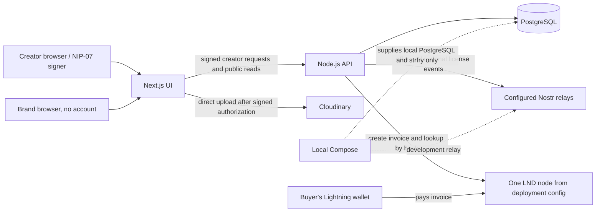

# ANZA Backend Production Readiness: Implementation Plan

**Status: Phases 1–3 implemented and committed. Phase 4 code is in progress under the approved provider-attestation policy. No mainnet payment, staging payment enablement, production configuration change, or deployment has been performed.**

This plan records repository evidence, product decisions, implementation progress, and remaining acceptance gates for the existing licensing engine. Real-money testing, environment enablement, and deployment require separate approval.

Paths below are relative to the `Licensing-Engine` repository root. Line references are to the inspected snapshot and should be rechecked when a phase starts. No secret values or `.env` contents were read.

## 1. Executive summary

The current product is a Node.js HTTP API and separate Next.js interface. The API stores offers and video metadata in PostgreSQL, verifies creator-signed Nostr events, queues offer and license events for relay publication, and signs Cloudinary upload parameters. The Lightning integration calls a single, locally configured LND REST endpoint. There is no creator payment destination field, creator-to-node mapping, buyer account, buyer acceptance record, payment table, license retrieval route, or protected original-download flow.

**Critical Lightning finding:** the LND node selected by `LND_REST_URL` creates the invoice. It is therefore the receiving node for that invoice. The documented Polar setup calls this the “Creator” node, so that particular demo can send value directly to that configured node. But the application does not establish that the node belongs to the creator associated with an offer; every offer uses the same deployment-level payment provider, and no subsequent payment to a creator exists. Runtime configuration and Polar node ownership are not in the repository, so the actual owner of any running node cannot be independently established.

The code has a useful foundation, but does not provide the intended end-to-end production purchase. In particular, public invoice creation is not per-creator or concurrency-safe, settlement is not linked to a buyer, license signing is optional, and the original media path is not protected for account-free buyers.

**Product and trust decisions recorded:** use Bitcoin mainnet Lightning for staging and production, real creator Lightning Addresses for direct-to-creator payments, Nostr Zaps (NIP-57), and Nostr relays to retrieve and validate Zap receipts. Brands remain account-free. Preserve the existing Node.js, Next.js, PostgreSQL, Nostr, and Cloudinary architecture. Anza must not hold creator funds, introduce a custodial balance, or implement a payout service. The approved policy accepts a valid kind 9735 receipt signed by the `nostrPubkey` advertised by the creator's HTTPS-authenticated LNURL-pay endpoint as that creator payment service's attestation. This is a trust in the receiver service, not independent proof that funds moved. A matching preimage binds a receipt to the invoice hash but is not, by itself, settlement proof. Runtime and public documentation must state this limitation clearly.

**Provider compatibility evidence and limits:** Wallet of Satoshi is not a required creator provider and creators must not be asked to switch without evidence. Its public product information confirms Lightning payments and paying Lightning Addresses, but does not establish that its receiving service accepts Zap requests or publishes kind 9735 receipts. Official LNbits LNURLp documentation/source describes Lightning Address support and signing/publishing NIP-57 receipts after payment; a creator-operated LNbits instance connected to that creator's own receiving wallet is a plausible non-custodial-to-Anza option, not a selected provider or verified live deployment. Its advertised receipt key is discovered through the HTTPS LNURL-pay response and must be snapshotted per purchase; key changes apply only to newly resolved purchases. No live provider/wallet payment or deployed-provider check has been performed. Implementation may proceed with mocked protocol/provider tests and compatible-provider support, but staging/production acceptance still requires the separately approved manual 1-sat check against a real creator endpoint.

Local Polar/regtest invoice and status tests remain regression coverage; do not repeat the completed sandbox exercise without a specific technical reason. Lightning Address payment tests against staging or production are manual-only: any real-money test is exactly 1 sat and requires explicit approval for that environment before it is initiated. Automated tests must never send mainnet payments. Never silently fall back from staging or production to Polar/regtest. Implementation does not authorize a real payment, staging payment enablement, production configuration change, or deployment.

## 2. Current architecture

### Verified components

| Component | Current role | Evidence |
|---|---|---|
| Next.js interface | Creator offer/content UI, public offer pages, and Lightning invoice/status UI. | `frontend/package.json`; `frontend/app/`; `frontend/lib/api.ts` |
| Node.js API | Native Node HTTP server and route matching; offer/content services and publication worker. | `backend/package.json`; `backend/src/server.js`; `backend/src/app.js` |
| PostgreSQL | Persists offer JSON documents, video records, idempotency records, upload sessions, Nostr outbox, and webhook receipts. | `backend/src/repositories/offers.js`; `backend/src/repositories/videos.js`; `backend/src/database/migrations/` |
| Cloudinary | Direct browser uploads authorized by API-signed parameters; watermarked preview/thumbnail URL construction. | `backend/src/services/media/cloudinary.js`; `backend/src/services/content/service.js` |
| Nostr | Creator-signed offer event, optional attestor-signed license event, relay publication via durable outbox. | `backend/src/services/nostr/events.js`; `backend/src/services/nostr/publisher.js`; `backend/src/services/offers/service.js` |
| LND / Polar | LND REST API client that creates invoices and checks them by payment hash. Config is restricted to an HTTPS localhost origin; README documents local Polar regtest. | `backend/src/services/payments/lnd-client.js`; `backend/src/config/index.js`; `README.md` |
| Local relay | strfry service in Compose for development. | `compose.yaml`; `strfry.conf` |
| Deployment platform | No tracked Cloud Run, Render, or Vercel deployment configuration found. | Tracked repository file listing; `compose.yaml` contains only local PostgreSQL and strfry. |

### Environment-specific payment strategy

| Environment | Payment network and implementation | Purpose and safety boundary |
|---|---|---|
| Local development | Polar with local LND on regtest (`PAYMENT_NETWORK=regtest`) | Safe development and existing regression tests without real funds. Keep the existing LND adapter on this path. |
| Staging | Bitcoin mainnet Lightning (`PAYMENT_NETWORK=mainnet`) with creator Lightning Address/LNURL-pay and NIP-57 receipts | Verify the real creator-direct flow manually using compatible wallets. Any real-money test is exactly 1 sat and requires explicit staging approval. Mainnet must never be silently replaced by Polar. |
| Production | Bitcoin mainnet Lightning (`PAYMENT_NETWORK=mainnet`) with the same approved creator-direct NIP-57 flow | Real creator payments and license issuance, enabled only after all gates and explicit production approval. Any production Lightning Address test is manual-only and exactly 1 sat, with separate explicit production approval before payment. |

**Smallest compatible configuration recommendation:** retain `NODE_ENV` for Node runtime behavior and add an explicit deployment environment selector (for example `APP_ENV=development|staging|production`) plus `PAYMENT_NETWORK=regtest|mainnet`. Require the pair to match the table above and fail startup on missing, unsupported, or inconsistent values when payments are enabled. `APP_ENV` is necessary because staging and production may both use `NODE_ENV=production` while requiring different approval and operational behavior. Select the existing local LND adapter only for the explicit development/regtest pair; select the LNURL/NIP-57 implementation only for staging/mainnet or production/mainnet. Do not infer network from credentials, provider URLs, or defaults. Keep mainnet secrets in the environment's secret manager, never source control; do not expose them in logs or frontend bundles. These are plan recommendations only, not a request to alter current configuration.

### Current flow



The buyer payment-to-node arrow expresses Lightning invoice mechanics and the application's configured receive invoice; the repository does not verify who controls that node. “Creator node” is the README's label for the local Polar node, not a stored creator-to-node relationship.

## 3. Confirmed findings from the code

### Offer, identity, and API

- `frontend/lib/nostr.ts` exposes NIP-07 `getPublicKey()` and `signEvent()` usage. It keeps creator private keys in the browser signer rather than sending them to the backend.
- `backend/src/middleware/auth.js` validates signed HTTP authorization events (kind 27235), binds protected requests to URL/method, and binds POSTs to body digest and idempotency key.
- `backend/src/services/offers/service.js` validates offer terms, derives identity from the authenticated public key, verifies publication events, and persists the draft/publication state.
- `backend/src/routes/offers.js` implements `POST /api/offers`, public `GET /api/offers`, `GET /api/offers/{id}`, `POST /api/offers/{id}/publish`, public `POST /api/offers/{id}/payment`, public `GET /api/offers/{id}/status`, plus two Speed-shaped webhook paths.
- `backend/src/routes/content.js` implements creator-authenticated video upload authorization, registration, list, read, and delete routes.
- There is no creator-profile/onboarding persistence or payment destination in `schemas.Creator`, the offer draft schema, the video schema, or migrations.
- `backend/docs/api-contract.md` and `backend/src/contracts/contract.js` include planned plural `/payments` paths, buyer acceptance, and buyer/creator authorization that are not implemented. The live route matcher uses singular `/payment` and `/status`.

### Source line references

These are code locations for the verified findings above; confirm line numbers again before implementation.

| Finding | Source references |
|---|---|
| Frontend API origin and payment calls | `frontend/lib/api.ts:16` (`API_BASE_URL`), `:109` (`createOffer`), `:184-193` (`createPaymentRequest`, `getOfferStatus`); `frontend/app/offers/[offerId]/pay/page.tsx:55-60` (invoice initiation), `:74-90` (status polling) |
| Nostr creator authentication | `frontend/lib/nostr.ts:99-127` (`signHttpAuthorization`); `backend/src/middleware/auth.js:7-24` (`authenticate`) |
| API routes and access | `backend/src/routes/offers.js:1-16` (`matchOfferRoute`, webhook routes); `backend/src/routes/content.js:1-10` (`matchVideoRoute`) |
| Offer create and publication | `backend/src/services/offers/service.js:47-75` (`create`); `:100-123` (`publish`) |
| Invoice request, response validation and persistence | `backend/src/services/offers/service.js:125-149` (`createPayment`); `backend/src/repositories/offers.js:15-22` (`saveOfferDocument`) |
| LND endpoint restriction, TLS and invoice APIs | `backend/src/config/index.js:40-48` (`readLndUrl`); `backend/src/services/payments/lnd-client.js:4-12` (local HTTPS transport with `rejectUnauthorized: false`), `:21-28` (client and localhost restriction), `:29-47` (`lookupInvoice`), `:49-75` (`createInvoice`) |
| Settlement and conditional license signature | `backend/src/services/offers/service.js:34-45` (`queueLicenseAttestation`); `:151-175` (`getStatus`); `backend/src/services/nostr/events.js:21-40` (`buildLicenseEvent`) |
| Webhook wiring | `backend/src/services/offers/service.js:177-189` (`lightningWebhook`); `backend/src/services/payments/speed.js:5-22` (`verifySpeedWebhook`); `backend/src/server.js:15-17` (service config spread); `backend/src/config/index.js:63-84` (`readConfig`, no Speed secret) |
| Nostr outbox and relay retry/quorum | `backend/src/repositories/offers.js:24-40` (`queueLicense`), `:90-116` (`publishNext`, one stored ACK and retry); `backend/src/services/nostr/publisher.js:30-40` (`Promise.any`) |
| Cloudinary upload, originals and previews | `backend/src/services/content/service.js:20-30` (`owned` includes `original_url`), `:33-68` (upload authorization and client registration), `:70-90` (owner library/get/delete); `backend/src/services/media/cloudinary.js:14-35` (watermarked preview and ordinary original URL), `:49-83` (upload authorization and asset reference) |
| Schemas and missing persistence/routes | `backend/src/models/schemas.js:14-42` (terms/creator/offer/payment/license shapes), `:62-69` (`OfferDraft`); `backend/src/models/commerce.js:36-41` (`DownloadGrant` schema only); migrations `backend/src/database/migrations/001_offers.sql:2-30`, `002_videos.sql:6-27`; route inventory above |
| Runtime, CORS and deployment | `backend/src/app.js:9-35` (CORS and server timeouts), `:66-85` (auth/errors); `backend/src/server.js:20-28` (worker/listen/shutdown); `backend/src/config/index.js:63-84` (host/port config); `backend/package.json:6-12` (Node version/scripts) |
| Existing tests and skipped DB coverage | `backend/test/day2.test.js:53-113`, `:210-282`; `backend/test/lnd-client.test.js:5-39`; `backend/test/postgres.test.js:27-58` (requires `TEST_DATABASE_URL`); `backend/test/content.test.js`; `backend/test/contracts.test.js` |

### Database and migrations

- `backend/src/database/migrations/001_offers.sql` creates `offers`, `api_requests`, `nostr_outbox`, and `lightning_webhooks`.
- `backend/src/database/migrations/002_videos.sql` creates `videos`, adds `offers.video_id`, and creates `upload_sessions`.
- These are version-controlled SQL migration files, but there is no migration-history table. `backend/scripts/migrate.js` applies every `.sql` file in sorted order each run; current SQL statements are mostly guarded with `IF NOT EXISTS`.
- No seed script was found. `backend/src/server.js` expects PostgreSQL to be initialized and fails at startup if it cannot query `nostr_outbox`.
- PostgreSQL access uses `pg.Pool` and `DATABASE_URL`. The package declares `pg`; no Supabase integration or configuration exists. Supabase's PostgreSQL endpoint could potentially be used as PostgreSQL, subject to connection and TLS configuration verification.

### Test baseline recorded for this plan

Executed `npm test` from `backend/` on 2026-10-22:

- **54 tests discovered; 52 passed, 0 failed, 2 skipped.**
- The skipped tests are the PostgreSQL transaction/outbox and content-persistence integration tests; the runner says to set `TEST_DATABASE_URL` to a disposable PostgreSQL database.
- Existing tests include validation/contracts, Nostr event construction, offer rules, mocked LND invoice creation/settlement, webhook HMAC behavior, Cloudinary signature generation, and content ownership. The LND tests use mocked responses; they do not establish production payment behavior.
- Running `npm test` at repository root returned “Missing script: test”; the test script is defined under `backend/package.json`.
- The manifests do not define a backend lint, format, type-check, or static-analysis script. The frontend has a Next lint script, but it is not a backend validation command.

These results are a baseline, not proof that untested PostgreSQL, Polar, Cloudinary, live relay, or Cloud Run behavior works.

## 4. Critical finding: existing Lightning payment flow and production path

### Current flow, end to end

1. A creator submits a draft through `frontend/lib/api.ts` → `POST /api/offers`. The API accepts licensing terms and optional `video_id`; it does not accept a Lightning Address, wallet ID, creator node ID, invoice, payment-provider account, or destination.
2. The creator signs the offer using the injected Nostr signer. The backend verifies it and queues the event for relay publication.
3. The brand opens the payment page. `frontend/app/offers/[offerId]/pay/page.tsx` calls `createPaymentRequest()` in `frontend/lib/api.ts`, which issues an unauthenticated `POST /api/offers/{id}/payment`.
4. `backend/src/services/offers/service.js` reads the offer amount and calls the single configured `paymentProvider.createInvoice({ amountSats: offer.terms.amount_sats, ... })`.
5. `backend/src/services/payments/lnd-client.js` posts to `/v1/invoices` at the LND endpoint in `LND_REST_URL`, with the configured LND macaroon. LND returns a BOLT11 invoice, which the service checks for a payment request, hash, and amount matching the offer, then stores as fields on that offer document.
6. The API returns `{ offerId, amountSats, paymentRequest }`. No buyer identifier or buyer acceptance is recorded.
7. The brand pays the invoice using a compatible Lightning wallet. On Lightning, the invoice's payee is the node that created/issued the invoice. In the documented Polar demo, that is the configured Polar “Creator” LND node. In a deployment, it is whichever node `LND_REST_URL` actually reaches; no code proves who owns that node.
8. The browser polls `GET /api/offers/{id}/status`. The backend looks up the stored payment hash through the same LND node. When LND reports settled, the backend saves `status: settled` and `settled_at` in the offer document.
9. If `NOSTR_ATTESTOR_PRIVATE_KEY` is configured, the backend builds and signs a license event and stores it in the Nostr outbox. The publisher attempts configured relays and considers the event published after one positive acknowledgement.
10. The flow stops at payment status/license event publication. There is no creator payout step and no licensed-buyer download authorization.

```mermaid
sequenceDiagram
  participant C as Creator browser
  participant UI as Next.js UI
  participant API as Licensing API
  participant DB as PostgreSQL
  participant LND as Configured LND node
  participant B as Brand wallet
  participant N as Nostr relays
  C->>UI: Enter offer terms and sign with NIP-07
  UI->>API: POST /offers (signed creator authorization)
  API->>DB: Save draft
  UI->>API: POST /offers/{id}/publish (creator-signed event)
  API->>DB: Queue offer event
  API->>N: Publish exact event; one ACK marks published
  B->>UI: Open shared offer link
  UI->>API: POST /offers/{id}/payment (public)
  API->>LND: Create invoice for stored offer amount
  LND-->>API: BOLT11 invoice + payment hash
  API->>DB: Save invoice in offer document
  API-->>UI: Invoice, amount, offer ID
  B->>LND: Pay invoice; this LND node receives the payment
  UI->>API: GET /offers/{id}/status (poll)
  API->>LND: Lookup invoice by payment hash
  LND-->>API: Settled state and settlement timestamp
  API->>DB: Save settlement in offer document
  opt Attestor private key configured
    API->>DB: Sign and enqueue license event
    API->>N: Publish license event; one ACK marks licensed
  end
  Note over API,B: No creator payout or buyer download grant is implemented
```

### Payment destination and creator payment

**How does the current implementation determine who receives the buyer's Lightning payment?** It does not look up a recipient from the offer or creator. The single deployment-level `LND_REST_URL` chooses the node that creates the invoice; that same node is queried for settlement. Consequently, that node is the invoice payee and receives the payment if it settles.

The README documents a Polar test with “Buyer” and “Creator” nodes in the same Polar network and configures the “Creator” node's REST port/macaroon. This demonstrates a direct payment to that configured demo node only if the Polar instance is configured as described and that node is operated for the creator. The repository contains no Polar topology/configuration file and cannot establish the running node's owner. It does not prove a different creator's node is selected for different offers.

No function sends an onward Lightning payment to the creator. No Lightning Address is accepted, resolved, or stored. No payout/withdrawal workflow exists. The code therefore does **not** route every buyer's payment to the corresponding creator unless deployment ownership is manually arranged so the single configured node is that creator's node; it cannot safely support multiple creators with distinct destinations as written. Under a deployment where Anza controls the configured node, that node would receive the payment, and the system has no mechanism to pass it on.

The local LND adapter builds an invoice using the exact stored offer price and checks the returned invoice amount against it. It then persists the amount and invoice hash in the offer JSON document. Settlement lookup verifies that the returned hash matches the requested hash and reads LND's settled status; the service trusts the previously stored amount rather than independently rechecking a settled invoice's amount/destination. No buyer is associated with the payment.

### Code-reference table

| Flow element | Code evidence | What the code establishes / limitation |
|---|---|---|
| Creator payment destination capture | `backend/src/models/schemas.js` (`Terms`, `Creator`, `OfferDraft`); `backend/src/services/offers/service.js:create`; migrations `001_offers.sql`, `002_videos.sql` | No destination is accepted or persisted. `Creator` is a schema only; no creator table/onboarding route exists. |
| Payment initiation | `frontend/app/offers/[offerId]/pay/page.tsx`; `frontend/lib/api.ts:createPaymentRequest`; `backend/src/routes/offers.js:matchOfferRoute` | Anonymous buyer calls public singular `/payment`; request carries offer ID only. |
| Invoice creation and payee | `backend/src/services/offers/service.js:createPayment`; `backend/src/services/payments/lnd-client.js:createLndClient().createInvoice`; `backend/src/config/index.js:readLndUrl` | One configured localhost LND node creates invoices. That node is the invoice payee. Config explicitly rejects non-local LND URLs; the client disables TLS verification for this localhost development call. |
| Offer amount association | `backend/src/services/offers/service.js:createPayment` | Invoice creation uses `offer.terms.amount_sats`, checks provider-returned amount, and stores invoice/hash/amount in that offer document. Concurrent calls can each create an invoice before either saves; no `idempotent()` transaction wraps external invoice creation. |
| Settlement detection | `frontend/lib/api.ts:getOfferStatus`; `backend/src/services/offers/service.js:getStatus`; `backend/src/services/payments/lnd-client.js:lookupInvoice` | Polling triggers backend lookup by stored hash; confirmed only when LND says settled. No webhook is used for this LND flow. |
| Payment persistence | `backend/src/repositories/offers.js:getOffer`, `saveOfferDocument`; `001_offers.sql` | Payment is nested in `offers.document`; there is no `payments` table, buyer record, destination field, or unique payment-hash constraint. |
| Webhook path | `backend/src/routes/offers.js:matchWebhookRoute`; `backend/src/services/offers/service.js:lightningWebhook`; `backend/src/services/payments/speed.js:verifySpeedWebhook`; `001_offers.sql` | Speed-shaped HMAC callback stores a receipt only. `readConfig()` does not expose a Speed secret, and `server.js` spreads config into the service, so this handler receives no configured secret and returns not configured. It does not settle an LND payment. |
| License event construction | `backend/src/services/offers/service.js:queueLicenseAttestation`; `backend/src/services/nostr/events.js:buildLicenseEvent` | Requires `settled_at` and the optional attestor private key. The event references offer event ID and creator pubkey and includes payment hash, amount and term dates; terms are in the referenced offer event. |
| License persistence | `backend/src/repositories/offers.js:queueLicense` | Stores `license_event_id`, `licensed_at`, and `licensing` status in offer JSON and inserts signed event into outbox; no standalone license row or retrieval endpoint. |
| Relay publication | `backend/src/server.js` worker; `backend/src/repositories/offers.js:publishNext`; `backend/src/services/nostr/publisher.js:createRelayPublisher` | Retries failed outbox messages with capped backoff; `Promise.any` lets one configured relay ACK mark publication. No three-relay quorum, relay retrieval, or independent availability guarantee. |
| Creator payout | Search of payment service, routes, migrations, and frontend API | No send-payment, payout, or withdrawal implementation. The selected Lightning Address model is a future direct-receive destination, not a payout mechanism. |
| Buyer download grant | `backend/src/services/content/service.js:owned`, `listMine`, `getOne`; `backend/src/services/media/cloudinary.js:originalUrl`; `backend/src/routes/content.js` | No grant/token/download route. Owner library responses include an ordinary original Cloudinary URL; discovery excludes it. No buyer gets authorization after purchase. |

### What Polar demonstrates — and does not

The tracked README describes a local Polar regtest network, a Buyer LND node, a Creator LND node, channel setup, invoice scan/payment, and status polling. The service's default URL and strict localhost check, `polar-lnd` adapter name, and LND client tests align with local Polar development. BOLT11's `lnbcrt` prefix denotes regtest; such an invoice is not payable on Bitcoin mainnet.

This setup can demonstrate a buyer node paying an invoice issued by the configured Creator node and the API observing that node's settlement. It does not demonstrate public/testnet/mainnet payment, per-creator recipient selection, Lightning Address discovery, production node security, business account ownership, creator onboarding, a creator payout, or buyer download authorization. No Polar network export, node configuration, channel backup, or reproducible Polar creation script is tracked. Exact node names/ports and channels must be checked in the Polar desktop application.

### Approved production flow and protocol boundaries

1. Creator authenticates with the existing Nostr identity and enters a real Lightning Address. The creator-signed offer binds that address to the terms. LNURL discovery does not prove the real-world owner of the wallet; creator destination ownership must be checked during the manually approved real-endpoint test and must not be claimed as an automated identity proof.
2. Creator publishes the existing creator-signed offer with immutable licensing terms and destination/version binding. A later address change cannot rewrite a published offer or redirect its purchases; new terms/destination require a newly signed offer version or replacement offer.
3. A brand opens the offer and starts a purchase without an Anza account. Anza creates a unique purchase record and constructs a signed NIP-57 kind `9734` Zap request that identifies the recipient, exact amount, offer event where applicable, and an allowlisted set of Nostr relays for receipt publication. Use a purchase-scoped ephemeral Nostr signer, not a fabricated buyer account; do not persist its private key. Persist the signed request/event ID against the internal purchase ID; do not assume a non-standard purchase-ID tag is understood by wallets or providers.
4. Anza resolves the creator Lightning Address through its LNURL-pay endpoint and submits the Zap request in the supported callback flow. The receiver returns a BOLT11 invoice whose description hash commits to the exact Zap request.
5. Anza validates the returned invoice's signature, network, exact amount, payment hash, expiry, payee data and description hash before showing it to the buyer's compatible wallet.
6. The buyer pays the invoice. The creator receives the payment directly through the creator's Lightning service; Anza never receives or forwards funds.
7. After the receiver says the invoice was paid, it should sign a NIP-57 kind `9735` Zap receipt and publish it to the request's relays. Anza queries its configured relays, retries boundedly, and validates the event signature, expected recipient/provider Nostr key, embedded request, request ID/purchase linkage, invoice, amount, and any available preimage against the invoice payment hash.
8. Anza applies an explicitly approved verification policy. A valid signed Zap receipt establishes that the expected recipient service attested to the zap; it is not by itself independent proof that Lightning settlement occurred. A matching preimage can associate the receipt with the invoice payment hash, but it is not by itself proof of settlement because the invoice creator may know the preimage before payment; do not treat it as independent settlement evidence. A pending, missing, or malformed receipt never becomes success based on a browser redirect, invoice creation, payer claim, or public unverified event.
9. Only a payment that satisfies the approved policy and exact stored purchase binding can atomically trigger one license event in the existing Nostr outbox. The Anza attestor signs the claim that Anza applied its verification policy and issued the license; that signature does not independently prove funds moved.
10. The account-free buyer receives the license and a purchase-bound capability for protected original media only after Phase 6 controls are complete. Public offer data or Zap events are never download credentials.

**Keep these artifacts distinct:** (a) kind `9734` is a signed Zap request passed to the LNURL service and committed into the invoice description; (b) the BOLT11 invoice is a signed request for payment, not settlement; (c) Lightning settlement is the network payment outcome, which the invoice alone does not prove; and (d) kind `9735` is the recipient service's signed receipt claim, discoverable via Nostr relays but not inherently independent proof of settlement. NIP-57 is draft/optional and its own text cautions that a zap receipt may be false if the publisher is rogue. A preimage matching the invoice hash checks correspondence but does not establish that payment occurred. Relay publication/retrieval proves availability of an event, not correctness of its payment claim.

**Verification policy decision gate:** before license-triggering implementation, define whether Anza trusts a correctly signed receipt from the creator's Lightning service as an authoritative provider attestation. If independent settlement evidence is required, NIP-57 receipt/preimage fields alone do not meet that requirement; identify and validate an additional authoritative mechanism or stop before license-triggering implementation. For receipt-only trust, document the trust boundary, recipient signing-key discovery and key-rotation checks, and the residual risk that a service can publish a false receipt. If the chosen policy cannot be implemented for Wallet of Satoshi or another intended creator service, stop and return with the measured limitation and smallest compatible alternatives. Do not silently add a payment intermediary or require creators to switch wallets.

### Wallet of Satoshi compatibility evidence

**Verified from publicly accessible product information:** Wallet of Satoshi advertises Lightning payments and the ability to pay Lightning Addresses. That establishes neither receiving payments to its own Lightning Address through NIP-57 nor service-side creation of kind `9735` receipts, publication to relays, receipt completeness, or a supported receipt-recovery/status API. No live Wallet of Satoshi zap payment was performed for this plan.

**Must be verified before implementation approval:** (1) the exact current Wallet of Satoshi app/platform/version and mainnet behavior; (2) whether the service accepts an Anza-generated kind `9734` request through its Lightning Address/LNURL-pay endpoint; (3) whether it generates and signs kind `9735` after payment; (4) how its `nostrPubkey` is discovered/authenticated and whether it publishes receipts to the requested relays; (5) whether the receipt contains the exact request, BOLT11, amount, recipient, and purchase-correlating fields; (6) realistic relay publication/visibility delay and retries; (7) supported behavior when payment succeeds but receipt is delayed, unavailable, or permanently absent; and (8) what support/provider-side evidence, if any, is available without revealing a buyer preimage or introducing custody. Perform any real Lightning Address payment check manually only; the payment amount must be exactly 1 sat and requires explicit approval for the relevant environment. Do not use real funds during planning absent that approval.

**Fallback and stop rule:** retry and reconcile a missing receipt as `pending/unknown`, never as paid or failed solely due to timeout. Use only a provider-supported status mechanism or other evidence approved by the verification policy. If Wallet of Satoshi cannot provide the required receipt flow and no supported fallback meets the policy, stop at this decision gate. Evaluate the smallest alternative: continue to support creator Lightning Addresses only where the provider supports valid NIP-57 receipts and the policy, while documenting Wallet of Satoshi incompatibility; require no creator wallet change unless tests prove it necessary and the user approves; do not add an intermediary/custodial provider.

References: [NIP-57 Lightning Zaps](https://github.com/nostr-protocol/nips/blob/master/57.md), [LUD-06 payRequest](https://github.com/lnurl/luds/blob/luds/06.md), [LUD-16 Lightning Address](https://github.com/lnurl/luds/blob/luds/16.md), and [Wallet of Satoshi](https://walletofsatoshi.com/). These references describe protocol/product claims, not verified provider implementation or a completed payment test.

### Decision status

**Resolved product decision:** use creator Lightning Addresses (LNURL-pay) as the intended direct-to-creator model; keep purchases account-free; preserve creator signature on the offer; Anza's attestor signs only the claim that Anza verified payment and issued a license; do not introduce an Anza-held balance or payout service without explicit approval.

**Resolved implementation policy:** accept the HTTPS-discovered receiver signing key as the provider attestation key, snapshot it per purchase, and never describe the signature or optional preimage as independent proof of settlement. Wallet of Satoshi is optional; use any creator Lightning Address endpoint that advertises NIP-57 support and produces a valid receipt. LNbits LNURLp is a documented candidate, but a specific creator-operated endpoint and relay publication behavior remain to be proven in the manual staging gate. Missing receipts remain pending/unknown and never issue a license. If no real creator endpoint can meet that policy, stop before enabling staging payments and present the smallest supported alternative; do not add custody or require a wallet change without approval.

## 5. Known gaps and risks

### Confirmed from code

| Priority | Finding | Practical impact / planning response |
|---|---|---|
| Critical for direct multi-creator payments | All offers use one deployment-level LND client; no Lightning Address or destination is associated with creator or offer. | Current payment path cannot direct each offer to its creator. Implement the approved Lightning Address/NIP-57 model only after provider, wallet, and verification-policy gates pass; bind an immutable offer destination version and per-purchase snapshot. |
| Critical for settlement proof | The current LND path can query its own invoices. NIP-57 defines a signed recipient receipt but explicitly does not make that event independent proof that payment occurred; the buyer wallet is not required to disclose a preimage. | Define whether the recipient's signed receipt is accepted as a trusted creator-service attestation. If independent settlement evidence is required, NIP-57 receipt/preimage fields alone do not establish it; identify another authoritative mechanism or stop before license-triggering logic. |
| Critical for licensed downloads | No buyer download-grant route or purchase receipt exists; original delivery URLs are ordinary Cloudinary URLs and exposed in owner library responses. | No safe way for a no-account buyer to obtain the original after payment or prevent unauthorized access if original is public. Confirm Cloudinary account access settings; then add short-lived/revocable purchase-bound grants. |
| High | Public `POST /payment` can create invoices concurrently; it does not require acceptance, buyer credential, idempotency key or transaction lock around provider creation. | Can create multiple payable invoices for one offer; late payment cannot be reconciled safely. |
| High | Payment record is embedded on offer JSON; no payment uniqueness/foreign-key/buyer association. | No durable multi-attempt payment ledger or buyer-specific recovery. |
| High | Webhook secret is not loaded/passed by server config; handler stores callbacks rather than processing/reconciling settlement. No timestamp freshness or event dedupe. | Do not use Speed callback as payment authority. Polling LND is the active settlement path. |
| High | Optional attestor private key means settlement can be reported without creating a license event. | Define production key custody and make “settled” vs “license published” distinct states and acceptance checks. |
| High | CORS `isAllowedOrigin` permits only HTTP localhost; parsed `corsOrigin` is not used. | Hosted browser UI at HTTPS domain cannot successfully make cross-origin API calls with current CORS response behavior. |
| High for Cloud Run | Default host is `127.0.0.1`; Cloud Run ingress expects `0.0.0.0` and injected port. Start script explicitly loads `.env`. | Runtime startup changes and container test required before deployment. |
| Medium | Raw public offer read returns the stored offer document, which may include payment invoice/hash/status fields. | Establish response projection/privacy contract before external API release. |
| Medium | Nostr publisher accepts one relay ACK, not a three-relay quorum; no event retrieval endpoint. | Match reliability policy to intended “independently verifiable” claim; ensure relay query verification tests. |
| Medium | `VideoRegistration` trusts browser-supplied Cloudinary status and metadata; original bytes are not verified by backend. | Verify asset with Cloudinary API/webhook before treating it ready or signing it as authoritative content. |
| Medium | Root README has schema naming drift (`ANZA.offer.v1` in prose vs `contentport.offer.v1` in code); API docs include planned routes as if in the contract. | Reconcile docs and API versioning in Phase 3; no event-format migration without compatibility review. |
| Medium | The API has no evident health/readiness route, rate limit, or production deployment pipeline/config. | Add only necessary runtime/operational controls and protect public routes before exposure. |
| Medium | No `LICENSE` file is tracked; README lists selecting one as future work. | Confirm the open-source boundary and license before external open-source release. |

### Requires account/runtime verification

- Cloudinary can be configured for private/authenticated delivery, but the repository does not reveal the account's delivery/access policy or current asset settings. Do not claim that current originals are all public or all private.
- The owner library endpoint returns an un-tokenized URL for the original asset. If the asset is publicly deliverable under account settings, anyone who obtains that URL can fetch it; if account policy protects it, delivery behavior depends on configuration. Verify both in the real account before launch.
- No code/config proves a Cloud Run service, managed database, Render service, DNS record, GitHub deployment pipeline, or business ownership of provider accounts.
- No backend `.env.example` is tracked even though backend setup docs refer to one. An untracked root `.env` exists in worktree status; it was not opened or copied.
- No repository evidence verifies a Voltage account, Kenya eligibility, current fee schedule, custody arrangement, or settlement terms.

## 6. Proposed target behavior

Preserve the intended creator-led/account-free brand journey:

1. Creator authenticates with Nostr signing capability; no private key is sent to the API.
2. Creator uploads to Cloudinary using a server-signed, restricted authorization. Backend confirms the resulting asset and processing state through trusted Cloudinary evidence.
3. Creator creates and signs an immutable offer that references verified content, fixed terms, and the creator Lightning Address/destination version; never include provider credentials or raw secrets.
4. Brand opens public offer details and watermarked preview without registration.
5. Brand chooses purchase; API records exact offer/terms acceptance, creates an idempotent per-purchase record and NIP-57 kind `9734` request, resolves a Lightning Address invoice, and returns the invoice with an account-free receipt capability.
6. Creator's Lightning service receives the payment directly and should publish a signed kind `9735` receipt to the request's relays. Anza retrieves and validates that receipt, invoice, request, creator/provider signing key and exact purchase association under the approved verification policy; absence or timeout remains pending/unknown.
7. Only a verified payment creates one license linked to the exact payment and offer. Anza's attestor signs only its claim that Anza applied the approved policy and issued the license; it does not independently prove funds moved.
8. Publish the exact signed event through the existing outbox; record relay acknowledgements and retry unchanged event bytes. Relay availability is not proof of settlement.
9. Return a secure, revocable, expiring download grant only after payment and license verification and Phase 6 media protections are complete. Buyer does not need an account.
10. Creator receives payment directly through the creator Lightning service; Anza never holds creator funds or forwards a payout.

## 7. Phased implementation plan

Phases are dependency-ordered. Each phase requires targeted tests, the existing backend suite, applicable static checks, an actual-results report, and an update to this plan before proceeding. A failed acceptance criterion pauses subsequent phases.

### Phase 0 — Code audit and baseline

- **Objective:** establish verified behavior before changing it.
- **Current state:** route/service/database/payment/media/Nostr paths were traced for this plan. Backend `npm test`: 52 pass, 0 fail, 2 skipped PostgreSQL integration tests. No actual Polar, Cloudinary, relay, Supabase, or Cloud Run integration was run.
- **Required changes:** none; this planning task is the audit. Before implementation starts, recheck all cited files and determine which untracked state is in-scope without opening or staging secrets.
- **Files to inspect:** `backend/src/services/offers/service.js`, `backend/src/services/payments/lnd-client.js`, `backend/src/services/nostr/`, `backend/src/services/content/service.js`, `backend/src/services/media/cloudinary.js`, `backend/src/repositories/`, `backend/src/database/migrations/`, `backend/src/routes/`, `backend/test/`, root `README.md`, backend docs.
- **Expected files to modify:** only `implementation-plan.md` during this plan task. During later execution, none for Phase 0 unless findings require a separately approved scope.
- **Expected modules:** offer/payment/content services, repositories, config, native HTTP app/server, and outbox.
- **Implementation steps:** mark baseline, clarify documented facts vs assumptions, capture test result, record live-infrastructure unknowns.
- **Database changes:** none.
- **API changes:** none.
- **Testing requirements:** baseline already run; rerun when Phase 0 is approved if source changed. Run PostgreSQL integration only with a clearly disposable database and explicit confirmation of its target.
- **Acceptance criteria:** all payment destination and signing claims cite code; skipped tests and unavailable systems remain explicitly identified.
- **Risks/dependencies:** current worktree includes untracked `.env`, `.kilo/`, and generated `frontend/tsconfig.tsbuildinfo`; do not modify or stage unrelated changes.
- **Rollback/recovery:** no application changes to roll back.
- **Approval gates:** approve the audit conclusions and select/authorize safe test PostgreSQL only if Phase 2 requires it.

### Phase 1 — Backend runtime and deployment readiness

- **Objective:** run the existing Node API as an independently deployable Cloud Run container without changing product behavior.
- **Current state:** `backend/src/server.js` uses `config.host`, `config.port`, and a periodic outbox worker. `backend/src/config/index.js` defaults host to loopback and reads app config. `backend/package.json` starts with `node --env-file=.env`. No health route/container is tracked. CORS uses a localhost-only predicate rather than `corsOrigin`.
- **Required changes:** support platform-provided `PORT`; bind to `0.0.0.0` under Cloud Run (while preserving local behavior); make `.env` optional for platform startup; add health/readiness checks; implement exact configured origin allowlist; document graceful shutdown and external dependency status; decide whether outbox worker is safe as an in-process worker with chosen Cloud Run CPU/min-instance settings or requires a separate process.
- **Files to inspect:** `backend/src/config/index.js`, `backend/src/server.js`, `backend/src/app.js`, `backend/package.json`, `backend/.gitignore`, `backend/README.md`, `compose.yaml`.
- **Expected files to modify:** existing config/app/server/package/docs; proposed `backend/Dockerfile` if a container file is selected; no exact health path is present today, so choose and document it during implementation (recommend `/health/live` and `/health/ready` only if no existing platform convention requires another).
- **Expected modules:** `readConfig`, `createApp`, server initialization, outbox tick/shutdown.
- **Implementation steps:** 1) define local-vs-platform config defaults; 2) ensure readiness includes DB and required schema, liveness does not fail on transient relay outages; 3) make CORS reflect configured HTTPS origins only; 4) containerize with Node 22 and a non-root runtime; 5) test actual startup in the container with injected port; 6) document environment names without values.
- **Database changes:** none.
- **API changes:** health/readiness endpoints; corrected CORS behavior. No payment/API redesign.
- **Testing requirements:** config unit tests; health/live vs readiness tests; CORS allow/deny/preflight tests; container smoke test; backend test suite; static checks if introduced/configured.
- **Acceptance criteria:** container binds on Cloud Run's injected port and all interfaces; a missing `.env` does not prevent valid platform configuration; readiness fails clearly for required DB/schema unavailability; only configured origins get CORS headers; local start still works.
- **Risks/dependencies:** Cloud Run outbox worker can scale/idle; in-process interval is not a durable scheduler guarantee. Avoid duplicate worker effects through the existing `FOR UPDATE SKIP LOCKED` claim plus multi-instance tests.
- **Rollback/recovery:** deploy as a new Cloud Run revision in staging; retain prior revision and route traffic back if smoke tests fail. Runtime changes must continue supporting local development.
- **Approval gates:** approve worker execution model and health contract before deployment.

### Phase 2 — Database setup and persistence

- **Objective:** initialize a fresh managed PostgreSQL instance reproducibly and upgrade existing schemas without destructive changes.
- **Current state:** version-controlled migrations 001/002 exist; `scripts/migrate.js` replays sorted SQL and has no migration ledger; tables and current relationships are listed in Section 3. No seeds. `pg.Pool` connects through `DATABASE_URL`.
- **Required changes:** use the existing SQL migration approach; add a migration-history/checksum mechanism only if needed to apply future migrations exactly once and detect drift. Ensure all current migrations can safely initialize a fresh PostgreSQL database and update an existing supported schema. Add pool/TLS configuration appropriate for the selected Supabase/GCP host. Do not introduce an ORM or a new migration framework without evidence it is required.
- **Files to inspect:** `backend/scripts/migrate.js`, all files in `backend/src/database/migrations/`, `backend/src/server.js`, `backend/src/repositories/offers.js`, `backend/src/repositories/videos.js`, `backend/test/postgres.test.js`, `backend/docs/local-database.md`.
- **Expected files to modify:** migration runner and relevant SQL/docs/tests; proposed new migration-history SQL migration or schema table if the approved approach needs it. Avoid modifying existing migrations already used against any shared DB.
- **Expected modules:** migration runner, PostgreSQL pool config, repository persistence.
- **Implementation steps:** 1) establish fresh-database run test; 2) decide migration bookkeeping before adding subsequent migrations; 3) implement safe one-time migration history; 4) validate migration ordering; 5) run against disposable PostgreSQL; 6) test re-run and existing-data upgrade path using a copy/snapshot, not production.
- **Database changes:** additive migration metadata is likely; no payment/download schema changes in this phase. Any destructive or irreversible DDL requires explicit approval and backup.
- **API changes:** none.
- **Testing requirements:** fresh DB setup; idempotent/repeat execution; upgrade fixture; transaction/idempotency/outbox/content persistence tests; backend regression suite. Supabase compatibility integration requires a dedicated staging instance, not an assumption based on PostgreSQL compatibility.
- **Acceptance criteria:** a fresh supported PostgreSQL database reaches current schema from repository instructions; a second migration run is a no-op or safely recorded; existing data remains intact; staging credentials are not stored in source.
- **Risks/dependencies:** need a clearly disposable database for integration; Supabase pooler/session mode, TLS and connection count must be verified with provider docs/current project.
- **Rollback/recovery:** migrations should be additive where possible; snapshot before application; provide explicit forward-fix or tested rollback scripts only when safe. Do not run migrations on production before backup/restore verification.
- **Approval gates:** confirm Supabase vs another PostgreSQL host and authorize a disposable/staging database.

### Phase 3 — API contracts and developer documentation

- **Objective:** make OpenAPI, Swagger UI and Postman describe only live behavior with minimal duplicated routing/schema definitions.
- **Current state:** Phase 3 is implemented and committed. `backend/src/contracts/contract.js` and `backend/scripts/export-contract.js` generate the OpenAPI document and local deterministic Postman collection; `backend/docs/openapi.json` and `backend/docs/postman_collection.json` are present. Swagger UI and production Basic Auth/read-only behavior are implemented. The API contract excludes unimplemented purchase/Zap routes.
- **Required changes:** no Phase 3 work remains. Preserve the contract-drift tests and update the OpenAPI/Postman docs only when Phase 4 payment routes are actually implemented; label experimental/unavailable behavior accurately. Keep production Swagger protected and read-only.
- **Files to inspect:** `backend/src/contracts/contract.js`, `backend/src/models/schemas.js`, `backend/src/models/content.js`, `backend/src/models/commerce.js`, `backend/src/routes/offers.js`, `backend/src/routes/content.js`, `backend/src/app.js`, `backend/scripts/export-contract.js`, `backend/docs/openapi.json`, `backend/docs/api-contract.md`, `backend/docs/day-2.md`.
- **Expected files to modify:** existing contract source, schemas as needed, export script, docs and generated `backend/docs/openapi.json`; proposed `backend/docs/postman_collection.json`; Swagger UI route/static integration in existing app or clearly scoped middleware/module. Exact UI file is contingent on chosen minimal serving method.
- **Expected modules:** route match metadata, request/response schemas, contract exporter, API documentation serving.
- **Implementation steps:** 1) list only actual routes; 2) define reusable response schemas/projections; 3) align OpenAPI path/auth/response/error definitions; 4) generate OpenAPI JSON; 5) generate Postman collection from OpenAPI; 6) serve Swagger UI only in selected environments; 7) test document drift in CI.
- **Database changes:** none.
- **API changes:** documentation-only except optional Swagger UI route. Do not change purchase authorization in this phase.
- **Testing requirements:** existing `contracts.test.js` generation/reference tests; add test asserting all matched routes appear in OpenAPI and no planned route is marked implemented; snapshot/example contract checks; backend suite.
- **Acceptance criteria:** `openapi.json` regenerates deterministically; every implemented method/path has accurate auth and schema; planned future purchase/download APIs are explicitly absent or marked planned; Postman collection imports; Swagger UI can execute read-only/dev requests safely.
- **Risks/dependencies:** code-first currently means schemas are reused but routes are duplicated between matcher and contract. A lightweight shared route metadata source is preferred; avoid a framework migration.
- **Rollback/recovery:** regenerate prior contract from source; do not delete old docs until equivalent content and import path are validated.
- **Approval gates:** completed for Phase 3: production Swagger UI is Basic-Auth protected and read-only.

### Phase 4 — Lightning payment production path

- **Objective:** support account-free purchases paid directly to a creator's real Lightning Address on mainnet, using NIP-57 Zap receipts retrieved and validated through Nostr relays under an explicitly approved settlement-verification policy.
- **Current state:** Phase 4 implementation adds environment-specific Polar/LND versus LNURL/NIP-57 selection, immutable Lightning Address offer terms, BOLT11 validation, purchase-scoped kind 9734 requests, relay retrieval and validation of kind 9735 receipts, durable purchase records, capability-token status, and atomic receipt/license/outbox persistence. Additive migrations preserve existing records and allow the existing offer event plus its license event to coexist in the outbox. All 76 backend tests passed, including PostgreSQL migration/transaction tests against a disposable database; the frontend production build and production-dependency audit also passed. The existing Polar/regtest tests remain unchanged as regression coverage. Live provider compatibility, destination ownership, real relay publication/visibility, and manual staging acceptance remain unverified.
- **Required changes:** preserve the existing LND adapter for local regtest only and replace the production payment path with a creator-address LNURL-pay/NIP-57 flow. Create a unique, idempotent purchase record and high-entropy account-free receipt capability (store only its hash); bind it to one immutable signed offer/version, creator identity and address snapshot, exact amount/network, Zap request ID, invoice/payment hash, provider signing key, expiry, and receipt state. Validate the invoice and signed receipt before any settlement state transition. Handle delayed/missing receipts as pending/unknown and retry relay discovery safely. Persist receipt/provider evidence and deduplicate on invoice/payment/purchase to prevent duplicate licenses. Never hold or forward creator funds.
- **Remaining acceptance gate:** automated implementation tests use mocks or local regtest and never make mainnet payments. Official LNbits LNURLp material is a possible creator-operated compatible receiver, not evidence of a live deployment. Wallet of Satoshi is optional and its complete Zap-receipt compatibility remains unverified. Any end-to-end Lightning Address test in staging or production is manual-only, exactly 1 sat, and requires separate explicit approval for that environment before payment. Do not repeat Polar sandbox work without a specific technical reason; retain and run the existing regression tests.
- **NIP-57 handling:** construct the kind 9734 request with exact amount, creator recipient, offer event where applicable, and configured receipt relays; persist its event ID against the internal purchase ID; submit it to the creator's LNURL-pay callback; validate the description-hash BOLT11 invoice. Retrieve kind 9735 events from configured relays with bounded retries and validate Nostr event ID/signature, expected provider `nostrPubkey`, embedded signed kind 9734 request, recipient/amount, invoice signature/network/amount/expiry/payee/description hash, and the stored request-to-purchase mapping, plus any included preimage against the invoice payment hash. A receipt without matching invoice/request/purchase is rejected.
- **Verification policy:** NIP-57 receipt validity proves that the expected recipient signing key published a receipt; it does not independently prove that the Lightning payment settled. The accepted trust policy treats the `nostrPubkey` discovered from the purchase's HTTPS LNURL-pay response as the creator service's attestation key, bound to the exact address and purchase snapshot. A matching preimage can verify correspondence with the invoice hash but does not alone prove settlement, since the invoice creator may know it before payment. Key rotation affects new purchases; existing purchases retain their snapshotted expected key. Never represent this receipt-only trust model as independent settlement proof.
- **Files to inspect:** retain review of `backend/src/services/offers/service.js`, `backend/src/services/payments/lnd-client.js`, `backend/src/services/payments/speed.js`, `backend/src/config/index.js`, `backend/src/controllers/offers.js`, `backend/src/routes/offers.js`, `backend/src/repositories/offers.js`, `backend/src/database/migrations/001_offers.sql`, `backend/src/models/commerce.js`, `frontend/lib/api.ts`, `frontend/app/offers/[offerId]/pay/page.tsx`, `backend/test/day2.test.js`, `backend/test/lnd-client.test.js`, and `backend/test/postgres.test.js`; add NIP-57 implementation and provider/wallet documentation inspection.
- **Implemented surfaces:** payment adapters and NIP-57 service, API routes/controller, fail-closed environment selection, repository and additive migration, OpenAPI/Postman contracts, frontend offer/purchase/status UI, protocol tests, and README/API trust documentation. The implementation does not add a payment intermediary or provider SDK.
- **Expected modules:** local `createLndClient`/existing tests for regtest; new LNURL resolver, Zap request builder, receipt retrieval/validation, payment persistence, purchase status/reconciliation, and integration with existing license outbox.
- **Implementation progress:** environment selection, offer/destination binding, idempotent purchase reservation, ephemeral Zap request signing, LNURL invoice resolution, exact BOLT11 checks, purchase capability response, relay polling, receipt field/signature/preimage checks, atomic single-license/outbox persistence, and account-free status are implemented and covered by automated tests. LNURL safety/amount handling, relay retrieval/retry behavior, receipt mismatch rejection, pending-on-missing/forged-receipt behavior, PostgreSQL migrations/transactions, API contracts, and frontend build have been validated. Remaining work before staging acceptance is external: manually verify one real compatible creator endpoint and intended creator receipt with an exactly 1-sat payment, only after explicit staging approval. Wallet of Satoshi compatibility is still unknown; no real payment or staging enablement has occurred.
- **Database changes:** additive `zap_purchases` persistence enforces unique invoice hash, one active purchase per offer, and idempotent purchase keys; raw buyer capabilities are stored only as hashes. A second additive migration removes the pre-existing one-outbox-event-per-offer uniqueness constraint so each offer can retain both its original signed event and its license event, while keeping unique event IDs and offer linkage. Integration tests verify legacy migration, purchase reservation, atomic receipt/license/outbox writes, and duplicate protection. Do not store raw receipt secrets; redact invoice/preimage values from logs; preserve existing offer JSON and migration history.
- **API changes:** replace the current public offer-scoped invoice/status behavior with minimum anonymous purchase initiation and secret-authorized purchase status/receipt endpoints. Do not require brand registration. Keep public offer discovery separate from purchase state. Existing in-flight legacy Polar records must remain readable/reconcilable in local development; do not silently route their invoices to mainnet or migrate ambiguous records as paid.
- **Address changes:** a destination change after publication cannot redirect an existing offer or purchase. Require a newly signed offer/version or close-and-replace; snapshot the normalized address and resolved provider/invoice data for every purchase. A pending invoice remains bound to its original purchase until expiry/settlement; disable new purchases if the destination becomes unusable.
- **Testing requirements:** existing Polar/regtest invoice creation/status tests continue to pass; test configuration mismatch/fail-closed behavior, LNURL resolution, exact invoice validation, NIP-57 request/receipt signatures and fields, recipient/provider key mismatch/rotation, correct/wrong offer/creator/amount/purchase, relay delay/outage/retry, delayed/missing/duplicate/forged receipts, matching/mismatching preimages, unpaid/expired invoices, concurrency/idempotency, restart recovery, late receipt/payment reconciliation, and PostgreSQL atomicity. Unit mocks supplement but do not replace explicit, approved mainnet staging validation.
- **Acceptance criteria:** (1) existing local Polar/regtest invoice and status tests pass as regression coverage; (2) staging configuration is mainnet and cannot fall back to Polar; (3) an explicitly approved manual 1-sat test uses a compatible real wallet and reaches the intended creator directly; (4) Anza retrieves and validates the corresponding kind 9735 receipt and binds it to creator, offer, amount, invoice, and purchase; (5) the provider-attestation policy and its lack of independent settlement proof are documented and reflected in API/UI naming; (6) unpaid, failed, forged, malformed, expired, wrong-amount, wrong-recipient, and mismatched purchases cannot issue licenses; (7) duplicate requests/receipts cannot issue duplicate licenses; (8) missing/delayed receipts remain pending and cannot issue licenses; (9) account-free purchase status works; and (10) no funds custody, balance, or payout service is introduced. Automated tests never pay mainnet invoices. The manual test remains unperformed and gated on explicit staging approval; production testing requires separate explicit approval.
- **Risks/dependencies:** NIP-57 is optional/draft and explicitly does not make a receipt independent proof of payment; Wallet of Satoshi receipt behavior is not yet verified; other Lightning Address providers may not support zaps; relay availability and key discovery/rotation; actual creator-beneficiary proof; mainnet fees, provider terms and regional availability.
- **Rollback/recovery:** payment feature stays disabled until policy and staging gates pass; local regtest retains its isolated LND behavior. Preserve existing payment JSON and reconcile any legacy records before migrations. Missing receipts remain pending/unknown; late receipts are safely reconciled idempotently. Never convert relay timeout into success or reroute an invoice.
- **Approval gates:** product decisions are fixed to mainnet staging/production, direct creator Lightning Address, NIP-57, relays, account-free purchases, no custody/payout, and accepting the HTTPS-discovered receiver key's signed receipt as a creator-service attestation. Wallet of Satoshi is optional; LNbits LNURLp is a documented compatibility candidate, not a selected or deployed intermediary. Before any real-money Lightning Address test in staging or production, obtain explicit approval for a manual 1-sat payment in that environment. If a real creator endpoint cannot meet the policy, stop before staging payment enablement and present the smallest supported alternative; do not silently require wallet changes or introduce an intermediary.

### Phase 5 — License issuance and independent verification

- **Objective:** make a single verified settlement cause one independently verifiable license attestation without conflating event signature and proof of payment.
- **Current state:** Phase 4 now signs and enqueues a license event atomically after the approved receiver-receipt attestation policy accepts a purchase. The event records the receipt and purchase references; its evidence type states that the receiver receipt is a provider attestation, not independent settlement proof. This phase remains necessary for independent event verification, relay quorum/retrieval policy, attestor key operations, and documentation. The outbox still marks publication after one relay ACK and there is no license retrieval API.
- **Required changes:** accept only a Phase 4 payment record that passed the approved NIP-57 receipt/settlement policy; make license issuance idempotent/transactional with payment state and outbox insert; define independent verifier rules and the exact trust statement for both the creator-service Zap receipt and Anza attestation; decide license event kind(s) and relay quorum; add per-relay acknowledgement records or documented quorum behavior; provide event retrieval via Nostr (and optional API lookup by offer/payment/event ID).
- **Files to inspect:** `backend/src/services/nostr/events.js`, `backend/src/services/offers/service.js`, `backend/src/services/nostr/publisher.js`, `backend/src/repositories/offers.js`, `backend/src/config/index.js`, `backend/src/database/migrations/001_offers.sql`, `backend/docs/nostr-events.md`, `backend/test/contracts.test.js`, `backend/test/day2.test.js`, `backend/test/postgres.test.js`.
- **Expected files to modify:** event builder/service/repository, additive outbox/relay persistence migration if quorum tracking is approved, config, verification docs/tests. No event schema rewrite until compatibility review.
- **Expected modules:** `buildLicenseEvent`, `queueLicenseAttestation`, `queueLicense`, `publishNext`, relay publisher.
- **Implementation steps:** 1) consume only Phase 4's verified purchase state; 2) define license event version and verifier, distinguishing recipient-signed NIP-57 evidence from Anza's issuance attestation; 3) map the approved evidence references into deterministic license fields; 4) atomically create one license per purchase and enqueue event; 5) isolate production attestor key access; 6) publish exact event with duplicate-safe retries; 7) validate by independently querying configured relays using a separate test client.
- **Database changes:** additive license record or uniqueness constraints may be needed to preserve one-license-per-payment/offer. Consider existing outbox unique `offer_id` semantics (one license per offer); do not silently change it if offer purchase policy changes.
- **API changes:** add an authenticated/receipt-safe license lookup only if Nostr-only retrieval is insufficient; public API is not required merely to verify an event that is retrievable by ID from relays. Add a public verifier guide/example.
- **Testing requirements:** cryptographic creator/attestor signatures; event relationship and term checks; missing/wrong key; settlement trigger; repeated polling; duplicate event; relay outage/retry; one-vs-three relay quorum; independent relay query/signature verification; PG atomicity.
- **Acceptance criteria:** independent client can find the exact license event and associated Zap receipt using documented references/tags, verify signatures and event relationships, and understand the distinct creator-service and Anza trust claims; a Phase 4-unverified or receipt-pending purchase cannot produce a license.
- **Risks/dependencies:** attestor-key loss/compromise; event kind/schema incompatibility; relay retention/availability; a relay ACK is not proof that all relays or future readers have it.
- **Rollback/recovery:** version event payloads; preserve old event verification; changes to kind/schema require a compatibility window and explicit migration/dual-read plan. Outbox retries reuse exact event IDs.
- **Approval gates:** approve attestor identity/key custody, license event kind, relay quorum, and public verifier trust statements before enabling staging license signing or describing relay publication as independently available.

### Phase 6 — Protected media and account-free purchases

- **Objective:** return the unwatermarked original only to an account-free buyer with a valid license issued for a Phase 4-verified purchase; Cloudinary protection remains an independent required control.
- **Current state:** direct upload is signed, restricted to configured folder and accepted formats; preview uses Cloudinary text-layer watermark. Owner list/get includes ordinary original URL. Public offer discovery omits original. Registration accepts client-supplied Cloudinary metadata/status; there is no Cloudinary callback or asset verification, no grant endpoint and no buyer account.
- **Required changes:** check Cloudinary private/authenticated asset configuration and choose supported signed delivery; verify Cloudinary upload result/asset metadata server-side before ready state; issue a cryptographically unpredictable, high-entropy account-free purchase receipt or download capability bound to a Phase 4-verified purchase and Phase 5-issued license, store only its hash, enforce expiry/one-time or limited-use policy, protect against unauthorized reuse, support revocation, and never expose original URL in a public projection. Do not enable staging downloads until Phases 4 and 5 have passed. Define a lost-receipt recovery process that does not require buyer registration and verifies control of the original purchase using evidence unavailable to an unrelated claimant; recovery must not transfer or reassign the purchase based only on public offer/payment details or a support request.
- **Files to inspect:** `backend/src/services/content/service.js`, `backend/src/services/media/cloudinary.js`, `backend/src/routes/content.js`, `backend/src/models/content.js`, `backend/src/models/commerce.js`, `backend/src/validators/record-rules.js`, `backend/src/database/migrations/002_videos.sql`, `frontend/components/content/UploadVideo.tsx`, `frontend/components/offer/ContentPreview.tsx`, `frontend/app/offers/[offerId]/pay/page.tsx`, `backend/test/content.test.js`, `backend/test/data-schemas.test.js`.
- **Expected files to modify:** Cloudinary service/config, content/download routes/service/repository, additive migration, schemas, frontend purchase receipt/download UI, docs and tests. Exact delivery method must be selected after checking the account features in use.
- **Expected modules:** `owned`, `register`, Cloudinary upload verification, new grant issue/consume service, license/payment lookup.
- **Implementation steps:** 1) inspect actual Cloudinary account policy; 2) choose private/authenticated delivery and lifetime; 3) verify uploads before marking ready; 4) require Phase 4 payment verification and Phase 5 license issuance before creating a grant; 5) generate a cryptographically secure receipt secret and return it once, persisting only a suitably protected verifier/hash; 6) authorize and deliver with short-lived signed URL/proxy, with atomic one-time/limited-use enforcement; 7) exclude secrets and originals from public responses, URLs where feasible, and logs; 8) define and test lost-receipt recovery that proves control of the original purchase without an account, public-data-only claim, or reassignment to another claimant.
- **Database changes:** implement the already-described `DownloadGrant` shape only if it matches the selected flow; store token hash, license/asset IDs, expiry/use/revocation timestamps and constraints. Ensure the raw secret itself never persists; model any recovery verifier/challenge so it is bound to the same purchase and cannot be used to claim another buyer's license.
- **API changes:** add receipt/grant retrieval/download endpoints; public preview stays public, creator library remains owner-only. Public Nostr event is never an access grant.
- **Testing requirements:** public routes never contain original URL/token; creator can only manage owned video; unpaid/expired/revoked/used grants rejected; valid purchase grants access; tampered asset/offer references rejected; receipt secrets are generated with a cryptographically secure source, are not stored or logged in raw form, and cannot be reused beyond the approved policy; concurrent/replayed redemption cannot exceed one-time/limited-use constraints; recovery succeeds only with purchase-bound ownership evidence and cannot be used by another claimant or to redirect/reassign a license; test lost-receipt flow without buyer registration; Cloudinary upload verification and signature tests; existing suite.
- **Acceptance criteria:** unauthenticated, unlicensed visitor can only get preview; buyer with a capability for the correct Phase 4-verified payment and Phase 5-issued license can retrieve the correct original for bounded time; no permanent public original URL is returned to brand/discovery; no brand account is required. Access tokens must be unpredictable, securely stored (raw token is never persisted), scoped to the correct settled purchase/license and asset, and protected against unauthorized or out-of-policy reuse. Staging download remains disabled until Phases 4 and 5 pass. If a buyer loses their receipt, a documented, tested recovery process must restore access without requiring account creation and must verify control of the original purchase so another person cannot claim, take over, or redirect it.
- **Risks/dependencies:** Cloudinary product plan/access settings; link theft and forwarding risk; browser history/referrer/log exposure; one-time tokens can make interrupted downloads difficult. Select reasonable token lifetime, reuse policy, and ownership-verifying recovery mechanism before implementation; if recovery cannot securely establish original-purchase control without accounts, stop and return for a product decision rather than allowing support-mediated reassignment.
- **Rollback/recovery:** feature-flag new download route; preserve original files and metadata; revoke grants without deleting creator assets; do not change existing original delivery settings until tested in staging.
- **Approval gates:** approve account-free receipt/recovery behavior and one-time vs expiring multi-use download policy.

### Phase 7 — Cloud Run staging and continuous deployment

- **Objective:** deploy the independently runnable backend to a controlled staging environment and automate tested revisions from GitHub.
- **Current state:** Phases 1–3 added and verified a backend container, health/readiness routes, migration runner, API docs, and protected production Swagger UI. A Cloud Run service, GitHub Actions deployment workflow, and Render config are not evidenced. User indicates a GCP project and billing access; repository alone cannot verify ownership/configuration.
- **Required changes:** create a staging-only service; provision image repository, service identity, Secret Manager bindings, database connectivity and ingress policy; define health checks; publish logs/alerts; establish migration job and smoke test. Set GitHub Actions to authenticate using Workload Identity Federation (not long-lived service-account key in repo), build/test, push, deploy a new staging revision, run health/smoke checks, and report deployment status. Configure explicit `APP_ENV=staging` and `PAYMENT_NETWORK=mainnet`; the payment feature remains disabled until Phases 4–6 pass their gates. Do not configure production secrets or deploy production in this phase.
- **Files to inspect:** `backend/package.json`, `backend/src/server.js`, `backend/src/config/index.js`, `backend/scripts/migrate.js`, `compose.yaml`, `.gitignore` files, repository workflow directory if present (none tracked at audit), and test commands.
- **Expected files to modify:** Phase 1 container/docs; proposed `.github/workflows/backend-staging.yml` or equivalent; deployment config file only if justified; no secrets or live project identifiers committed unless approved as non-sensitive configuration.
- **Expected modules:** CI build/test, Artifact Registry image, Cloud Run revision deployment, verification and rollback.
- **Implementation steps:** 1) confirm staging project/region/service names; 2) provision minimum IAM; 3) create staging DB and secrets outside Git; 4) run migration as a distinct controlled job; 5) build/push immutable image; 6) deploy new revision with controlled traffic; 7) run health, CORS, database, signed creator request, relay, and environment/network fail-closed smoke checks; 8) retain prior known-good revision; 9) keep payment and download endpoints disabled until their prerequisite verification phases pass and are explicitly enabled; 10) document rollback command/procedure.
- **Database changes:** staging migration only, after Phase 2; production migration not part of staging deployment.
- **API changes:** no new product endpoints beyond approved health and docs.
- **Testing requirements:** CI tests, container smoke, Cloud Run health/readiness, staging dependency connectivity, migration outcome, CORS, environment/network mismatch rejection, and rollback test in non-production. Staging is mainnet by configuration but payment remains disabled until Phase 4/5 verification and Phase 6 download protection are complete. Do not initiate a real Lightning payment without separate explicit approval.
- **Acceptance criteria:** push to approved branch creates a staging revision after tests pass; failed build/test does not deploy; unhealthy revision receives no production traffic; last-known-good revision remains deployable; operator can explicitly restore traffic. Staging runtime is explicitly mainnet and cannot silently select Polar/regtest, while unverified payment and download flows remain disabled. Cloud Run retains revisions, but automatic rollback for arbitrary app-level failures must not be assumed.
- **Risks/dependencies:** confirm actual project, billing, IAM, region, VPC/DB routing and GitHub ownership. Outbox worker scaling and DB connection pooling need staging observation. Cloud Run custom domains: production docs recommend a load balancer; Cloud Run domain mapping remains preview/limited and is not recommended for production.
- **Rollback/recovery:** use Cloud Run revisions and explicit traffic reassignment to prior healthy revision; preserve immutable image digest. Database rollback is separate—use forward fix or tested recovery from backup, never assume traffic rollback reverses a migration.
- **Approval gates:** approve project/region, staging branch (recommend merge to `main` deploys staging), secrets and IAM setup, traffic policy and rollback test before enabling workflow. Staging deployment approval does not authorize a mainnet payment or public payment/download enablement. Production deployment requires separate explicit approval.

### Phase 8 — End-to-end verification and production-readiness review

- **Objective:** prove the intended creator-to-brand journey and operational recovery, not merely that the server starts.
- **Current state:** latest backend suite passed with PostgreSQL integration tests against a disposable database. No real mainnet creator Lightning Address payment, Wallet of Satoshi Zap, independent Zap-receipt relay retrieval, or Cloudinary-account verification has been performed.
- **Required changes:** execute full staging journey on Bitcoin mainnet with an approved creator Lightning Address and compatible wallet; manually perform any real Lightning Address payment test for exactly 1 sat only after explicit staging approval; independently retrieve and validate kind 9735 receipt and license events; verify account-free purchase and protected-download recovery; collect backup/restore and rollback evidence; complete the service-account ownership checklist. Never treat test coverage or a mock as approval for a real payment.
- **Files to inspect:** all changed modules from Phases 1–7, test output, staging configuration (without exposing secret values), monitoring/alert configuration and provider/account runbooks.
- **Expected files to modify:** only this plan and test/runbook documentation as gaps are found; application fixes require phase approval and stop/go.
- **Expected modules:** creator UI/API, payment destination/provider, license attestation, media grants, relay publisher, DB migrations, Cloud Run operations.
- **Implementation steps:** run clean end-to-end test from a new creator-signed offer through the approved mainnet Zap request/invoice/payment, relay-discovered receipt, license event, independent verification and protected download; test delayed/missing/duplicate/forged/mismatched receipt, expiry, outage and restart paths; restore a DB backup to a separate target; execute staging rollback; review ownership checklist; record remaining risks and launch gates.
- **Database changes:** none except if separately approved correction is required.
- **API changes:** none except approved compatibility fix.
- **Testing requirements:** backend regression suite including Polar/regtest tests; PostgreSQL integration; manual, explicitly approved 1-sat mainnet Lightning Address payment from a compatible wallet; confirmation of direct creator receipt; NIP-57 receipt retrieval/validation from relays; Cloudinary staging; independent license relay fetch/signature; unauthorized download checks; Cloud Run deployment/rollback and backup-restore tests. Automated tests must not initiate mainnet payments.
- **Acceptance criteria:** required user journey passes without brand account; approved evidence confirms funds reached the intended creator directly; NIP-57 receipt and Anza license claims are validated and not conflated; unpaid/unverified purchase cannot issue a license; one license event per purchase can be independently found and verified; original stays protected until Phases 4–6 pass; delayed or missing receipts do not grant access; failures recover without duplicate licenses; no custody or payout service exists; operational owners and support path are documented.
- **Risks/dependencies:** real-world provider availability, relay retention, content access and customer support; the phase must not mark unresolved controls “passed.”
- **Rollback/recovery:** do not cut over production traffic until all blockers are cleared; retain staging and prior deployment; disable payment/download features if an incident occurs.
- **Approval gates:** explicit go/no-go approval for each manual 1-sat real Lightning Address test, separately for staging and production, and separate explicit go/no-go approval for production deployment/payment launch. No real payment or production deploy occurs as part of plan updates or implementation absent the relevant approval.

## 8. API documentation strategy

Keep the existing code-first direction: JSON schemas in `backend/src/models/` are already used by runtime validation and `backend/src/contracts/contract.js`; `backend/scripts/export-contract.js` exports `backend/docs/openapi.json`. Improve alignment rather than replacing the native HTTP server.

1. Make route metadata a single source of truth (or add a contract completeness test if a shared route table is disproportionate). Include method, path, handler, public/creator/trusted-service access, request schema, response schema and errors.
2. Reconcile actual singular `/payment` and `/status` routes with existing planned plural `/payments` contract. Do not publish non-existent routes as usable.
3. Document the signed Nostr HTTP authorization format, body hashing, idempotency requirement, owner checks, public read projection, error envelope, 64 KiB body limit, and configured CORS.
4. Represent payment, webhook, license, receipt, and download operations as unavailable/planned until implemented and tested. Do not document brand accounts.
5. Generate `backend/docs/openapi.json` deterministically from contract source. Add a test that contract paths/methods correspond to the route matcher and that every `$ref` resolves.
6. Generate `backend/docs/postman_collection.json` deterministically from the same OpenAPI specification with the repository's local exporter. Include example variables for API base URL and creator authorization placeholders; no secrets.
7. Serve Swagger UI in development/staging only, or protect it if available publicly. Ensure “Try it out” does not call production by default. Document how to import the Postman collection and set a staging API URL.

The existing machine-readable contract is useful but currently diverges from runtime routes and includes planned buyer/payment authorization assumptions. Correct that discrepancy before treating it as a public API.

## 9. Cloud Run deployment and rollback strategy

### Proposed controlled delivery

1. Use a separate `staging` Cloud Run service and database, isolated from production data and secrets.
2. Containerize the existing Node 22 backend; listen on `0.0.0.0:$PORT`. Use a non-root runtime, pinned build inputs, and immutable Artifact Registry image digests.
3. Store credentials in Secret Manager and grant access to a dedicated least-privilege Cloud Run service account. Use private database networking/authorized connectivity and TLS as required by the selected Postgres host.
4. Run migrations as a distinct controlled deployment step/job before routing traffic. Do not run destructive schema changes automatically on every app startup.
5. Configure liveness/readiness. Readiness should check DB/schema availability; relay/Lightning dependency outage should be observable and should not necessarily cause restart loops if those features are disabled.
6. Use structured logs with request IDs; redact Authorization values, macaroons, webhook signatures, receipt secrets, payment preimages and full invoices where not needed. Add alerts on error rate, readiness failure, outbox retry backlog, DB saturation, payment reconciliation failures, and Cloudinary failures.
7. Configure exact CORS origins, ingress policy, edge rate limiting/abuse protection, and API-level limits.
8. GitHub workflow (recommended: GitHub Actions + Workload Identity Federation) runs backend tests/static checks; builds and pushes image; deploys a staging revision; waits for readiness; runs smoke tests; keeps previous healthy revision. Only promote/route after successful verification.
9. Cloud Run retains revisions, but deployment success does not guarantee application-level correctness. Workflow/operator must explicitly leave traffic on the last-known-good revision if verification fails and use explicit traffic reassignment to restore it.
10. Custom production domain should use an HTTPS load balancer in front of Cloud Run if production routing/control is needed; official Cloud Run documentation calls direct domain mapping preview/limited and not recommended for production.

### Staging checklist

- `0.0.0.0:$PORT`, no required local `.env`.
- Staging-only `DATABASE_URL`, Nostr relay(s), public origin, event kind, public attestor key and secret references in managed configuration.
- Set `APP_ENV=staging` and `PAYMENT_NETWORK=mainnet`; reject inconsistent/missing settings. Keep payments disabled until Phases 4 and 5 pass their verification gates; keep downloads disabled until Phase 6 passes. Store any required provider/attestor credentials only in Secret Manager.
- Cloudinary staging folder/account or safe test assets; no production originals.
- Health endpoints, CORS, API auth, DB persistence, outbox retry and logs verified.
- Migration applied only to staging database; rollback route and retained revision tested.
- No production DNS cutover or live payment in the initial staging deployment. Any later Lightning Address payment test is a manual 1-sat mainnet payment and requires separate explicit staging approval.

Official operational references reviewed for this plan: [Cloud Run container contract](https://docs.cloud.google.com/run/docs/container-contract) (ingress listens on `0.0.0.0` and injected port), [request timeouts](https://docs.cloud.google.com/run/docs/configuring/request-timeout), [concurrency and autoscaling](https://docs.cloud.google.com/run/docs/about-concurrency), [WebSockets and timeout behavior](https://docs.cloud.google.com/run/docs/triggering/websockets), [Secret Manager integration](https://docs.cloud.google.com/run/docs/configuring/services/secrets), and [custom-domain options and limitations](https://docs.cloud.google.com/run/docs/mapping-custom-domains). Verify current quotas, region availability and pricing again when provisioning.

## 10. Testing strategy

### Existing suite

`cd backend; npm test` runs Node's built-in test runner. The latest full suite was **58 passed, 0 failed, 0 skipped** against a disposable PostgreSQL instance. Tests use test doubles for invoice creation/status and relay behavior; one real Nostr signature test ran with installed dependencies. Existing Polar/LND tests are regression coverage, not a reason to repeat the sandbox payment. No configured backend lint/type-check/format script is present.

### Required phased gate

After each approved phase:

1. Run focused tests for the changed route/service/repository/config.
2. Run the full backend `npm test` regression suite.
3. Run configured lint/static checks; add a focused check only when the phase introduces one and keep it repeatable.
4. Run PostgreSQL integration tests only against an explicitly disposable/staging database.
5. Report actual pass/fail/skip counts and investigate introduced failures before continuing.
6. Update the phase status and evidence in this plan.

### Minimum new coverage by behavior

- API: route-to-OpenAPI completeness, schema validation, unauthenticated and unauthorized access, CORS allow/deny, malformed JSON/oversize payload, health/readiness.
- Persistence: fresh DB migration, migration re-run/history, constraints, idempotency, concurrent invoice/payment creation, settlement and license transaction.
- Lightning: preserve local Polar/regtest tests; validate exact mainnet amount/destination and invoice; NIP-57 kind 9734/9735 signatures and correlations; provider signing-key discovery/rotation; delayed, missing, duplicate, forged, mismatched receipts; any matching preimage; network expiry/late settlement; restart/reconciliation. A mock proves only adapter logic, not provider or wallet behavior.
- Nostr: creator/attestor signature validity, event linkage, exact offer data, duplicate event, relay rejection/timeouts, required relay quorum, independent relay retrieval and verification.
- Cloudinary/download: upload-result verification, correct preview watermark, original absent from public projection, no access before settlement, wrong/expired/revoked/used receipt denial, authorized account-free buyer delivery.
- Deployment: container startup, health endpoint, injected env, migration stage, staging smoke, deploy verification and explicit traffic rollback.
- Preserve existing Node test runner. Do not introduce Playwright unless a concrete browser-only requirement cannot be tested through current focused backend/contract tests.

## 11. External service ownership checklist

Repository inspection can show which integrations exist, not who owns the live accounts. Confirm ownership with account administrators before launch.

| Service | Current use evidenced in repository | Ownership status / action before production |
|---|---|---|
| Google Cloud / Cloud Run | User states project and billing exist; code has no Cloud Run config. | Account/project ownership cannot be verified here. Confirm Anza Limited organization ownership, billing, IAM, region, audit logs, support contacts and staging/production separation. No resource transfer evidenced. |
| PostgreSQL / Supabase | PostgreSQL `pg` pool and Docker local database are implemented; Supabase is proposed, not configured. | Choose host. If Supabase, create Anza-owned project, verify database connection mode/TLS/pooler/network, backup/PITR availability, region and billing. Apply existing migrations to a new project; no app data migration is evidenced. |
| Cloudinary | Optional Cloudinary integration and configuration code exist. | Account/cloud ownership and plan unknown. Confirm Anza business ownership, billing, asset access mode, private delivery/signing feature, backups/export, folder and API key rotation. Migrating assets is not required unless ownership/account is wrong; verify transfer restrictions first. |
| Lightning Address and Zap service | Local Polar/LND exists only for development regression; no mainnet creator-address or NIP-57 integration is configured. | Keep Polar isolated to development/regtest. For staging/production, verify provider ownership/terms/fees/availability in Kenya, creator-beneficiary linkage, kind 9735 signing and relay publication, key discovery/rotation, Wallet of Satoshi compatibility, and the approved receipt trust policy. Store any credentials in managed secrets. |
| Nostr signer/attestor | Creator key remains with browser signer; optional server attestor secret is supported by config. | Identify Anza business key custodian, generate/store production key safely, define rotation/recovery and access policy. Creator key ownership remains with creators. |
| Nostr relays | Relay URLs are runtime config; local strfry included. | Relay operators/account ownership unknown. Select independent relays, verify terms, retention, availability, and target quorum; relay data is replicated, not owned/controlled by Anza. |
| GitHub | Repository branch is `main`; no deployment workflow tracked. | Verify repo organization/owners, branch protection and Actions permissions. Use workload identity federation rather than static cloud keys; no account transfer indicated by repository. |
| Speed webhook | Speed-specific webhook parser/verifier code and route exist, but secret is not wired and callback does not settle current LND payments. | Treat as unused/incomplete until a corresponding Anza-owned/approved provider account and verified callback contract are confirmed. Do not deploy webhook as payment authority. |

Do not expose or commit account IDs, API credentials, macaroons, signing keys, webhook secrets, database URLs or payment receipts. Account transfers, asset migration, key transfer, and provider eligibility depend on external provider policies and must be confirmed directly.

## 12. Decisions and questions requiring my input

1. **License attestor and relay threshold:** What relay acknowledgement/retrieval policy is required (for example, one vs target three)? These cannot be determined from code or protocol alone.
2. **Account-free download capability policy:** Approve whether buyer download capabilities are one-time or short-lived multi-use with revocation/recovery. Recommendation: high-entropy secret, hashed at rest, scoped to a verified purchase/license and asset, bounded expiry, and revocable with a tested recovery path.
3. **Infrastructure confirmation:** Who can confirm the Cloud Run project/region, selected PostgreSQL host, Cloudinary business account/access policy, and service account ownership? This blocks staging configuration and production readiness.

All other choices should be resolved by code inspection, safe tests, or current technical documentation during implementation instead of requesting speculative product decisions.

## 13. Approval checklist

- [x] Product decisions recorded: mainnet Lightning for staging/production; direct creator Lightning Addresses; NIP-57 Zap receipts via relays; account-free brand purchases; no Anza custody, balance, or payout service.
- [x] Approve Phase 4 trust policy: a valid receipt from the HTTPS-discovered receiver key is accepted as the creator payment service's attestation, not independent proof funds moved; Wallet of Satoshi is optional.
- [ ] Complete a manual, real-endpoint staging compatibility check with exactly 1 sat after separate explicit staging approval; do not automate it.
- [ ] Explicitly approve each manual 1-sat mainnet Lightning Address test in its environment before it is initiated; staging and production approvals are separate.
- [ ] Approve attestor identity/key custody and Nostr relay threshold before Phase 5.
- [ ] Approve account-free receipt/download expiry and recovery behavior before Phase 6.
- [ ] Approve Supabase or another PostgreSQL host and a disposable integration/staging database before database work.
- [ ] Approve staging Cloud Run project/region, GitHub branch trigger, least-privilege identities and rollback policy before Phase 7.
- [ ] Confirm external account ownership and Cloudinary original-access settings before production use.
- [ ] Enable staging downloads only after Phases 4–6 pass; passing one phase does not authorize later phases.
- [ ] Require separate explicit approval for production configuration, deployment, and payment launch.

### Working procedure after approval

For each approved phase, restate scope and acceptance criteria; re-inspect relevant current files; implement only that phase; run focused and full regression tests; run relevant static checks; report files changed and actual results; update this plan with status/evidence; and stop at failed acceptance criteria or a decision gate. Do not weaken tests or claim unrun tests passed. Do not run production deployment or destructive/irreversible migrations without explicit approval.
